## What is the dataset?

One of the difficulties with producing hyperspectral mineral maps is knowing whether they are right. 
We can make maps that look geologically plausible, but testing the actual mineral identifications requires independent mineralogical data.

Fortunately, Thiele *et al.* (2026) have published exactly the sort of dataset we need.

Their work combines Mineral Liberation Analysis (MLA) with co-registered hyperspectral imagery from 206 rock samples, 
covering a wide variety of geological settings. The hyperspectral data span the VNIR, SWIR, MWIR and LWIR, and the MLA provides independent 
measurements of the mineral assemblages.

The authors use these data to train and benchmark machine-learning methods for predicting quantitative mineralogy from hyperspectral measurements.

I'm interested in something rather different. What happens if we run the hyperspectral data through Tetracorder, 
using its existing mineral identification rules, and compare the resulting maps with the MLA?

The dataset and associated publication are freely available:

Publication

[Thiele, S.T., Kirsch, M., Frenzel, M., Tolosana-Delgado, R., Kamath, A.V., Guy, B.M., Kim, Y., Tuşa, L., Járóka, T. and Gloaguen, R. (2026):
Predicting Mineralogy with Hyperspectral Data: A Benchmark Dataset and Machine Learning Framework to Enable Hyperspectral Geometallurgy; Minerals, 
16(7), 674.](https://www.mdpi.com/2075-163X/16/7/674)

Dataset

[Thiele, S.T., Kirsch, M., Frenzel, M., Tolosana-Delgado, R., Kamath, A.V., Guy, B.M., Kim, Y., Tuşa, L., Járóka, T. and Gloaguen, R. (2026):
Data for Upscaling Mineralogy with Hyperspectral Data: A Benchmark Dataset and Machine Learning Framework to Enable Hyperspectral Geometallurgy; 
RODARE, Helmholtz-Zentrum Dresden-Rossendorf.](https://rodare.hzdr.de/record/4582)

## Tetracorder 

I am going to use three samples from the benchmark dataset for illustration during this note (must have images!):  
  
|Hole|Sample|
|---|---|
|Collinstown|bS24|	
|Freiberg|E030B_C12|	
|Bösenbrunn|bBB_Sample8|  
   
A little bit of context, taken from Thiele *et al* (2026):  
  
- **Collinstown**, Zn–Pb prospect in County Westmeath, Ireland, drilled by Teck Ireland. The mineralogical setting includes dolomitisation, 
hydrothermal alteration and Zn–Pb mineralisation associated with Irish-type deposits.  
- **Freiberg**, Germany, drilled by Excellon Resources in 2020. Volcanics, metamorphics and hydrothermal alteration.
- **Bösenbrunn**, Germany, drilled in the 1970s. Volcanics, volcaniclastics, sedimentary clastics and hydrothermal alteration. 

### Running Tetracorder  

The dataset is organised using the hylite ecosystem (hylite, hycore, hyshed). To run Tetracorder on each sample:  

```python  
from pathlib import Path
import hycore

shed_path = Path("/Path/to/Helmholtz_Benchmark_set/MLA/MLA.shed")
shed = hycore.loadShed(shed_path)

box = shed.get("<hole>").get("<sample>")
```  

The hyperspectral data distributed in the dataset is stored as fractional reflectance with the full band range present and no smoothing. The pre-processing method 
described in the paper included clipping the first and last 10 bands and smoothing with a Savitzky-Golay algorithm using a first order polynomial with a 
window size of 5.  
  
To me, this seems like an unusual parameter choice for smoothing (a first-order Savitzky–Golay filter is effectively a
moving average) and it may be more appropriate for the ML applications that the dataset was designed for. For
Tetracorder, I pre-processed with a second-order polynomial and a window size of 11.  

As the Tetracorder rules only cover the VNIR-SWIR range, we will only use the Fenix data from the dataset.

```python  
import scipy as sc
import numpy as np

from tetracorderp import GroupEvaluator  

WINDOW = 11
POLY = 2
SLICE = slice(10, -10, None)  

fenix = box.get("FENIX")
identifier = f"{box.holeName()}_{box.name}"

data = fenix.data[..., SLICE]
wavelengths = fenix.get_wavelengths()[SLICE]
fwhm = np.asarray(fenix.header.get_list("fwhm"), dtype=float)[SLICE]  

assert data.shape[-1] == len(wavelengths) == len(fwhm), (
    f"Shape mismatch: data={data.shape[-1]}, "
    f"wavelengths={len(wavelengths)}, fwhm={len(fwhm)}"
)

# Identify spectra with all finite bands - savgol chokes on NaNs
valid_pixels = np.all(np.isfinite(data), axis=-1)

# Allocate output, retaining NaNs for invalid pixels
run_cube = np.full(data.shape, np.nan, dtype=np.float32)

# Smooth only valid spectra
run_cube[valid_pixels] = sc.signal.savgol_filter(data[valid_pixels], WINDOW, POLY, axis=-1)

run = GroupEvaluator(
    run_cube,                                  # The smoothed, pre-processed sample data
    wavelengths / 1000,                        # convert nm to um required by Tetracorder
    fwhm / 1000,                               # convert nm to um required by Tetracorder
    mode="default",                            # Tetracorder's default preset thresholds (this work might lead to a new "core" preset)
    masked_pixels=~valid_pixels,               # mask pixels with NaN                
    temperature=(288, 298),                    # Room temperature in kelvin
    disabled_materials=disabled_materials,     # Core scanning specific disabled list (exclude water, ice, vegetation etc)
    disabled_groups=disabled_groups,           # Core scanning specific disabled list (exclude water, ice, vegetation etc)
    disabled_cases=disabled_cases,             # Core scanning specific disabled list (exclude water, ice, vegetation etc)
)
run.write_npz(OUTDIR / (identifier + f"_tetracorder_run_{WINDOW}_{POLY}.npz")) # persist results for later evaluation
```  
  
From the results, we can examine what Tetracorder thinks of these samples.  
  
### Tetracorder results  
  
#### Collinstown  

::: {layout="[[1, 1], [1, 1]]"}

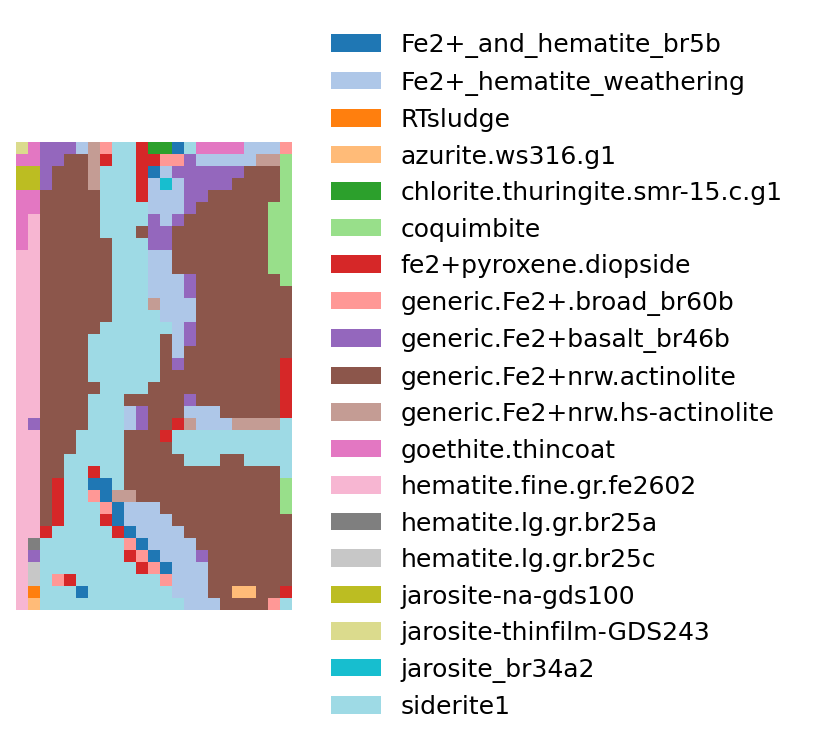

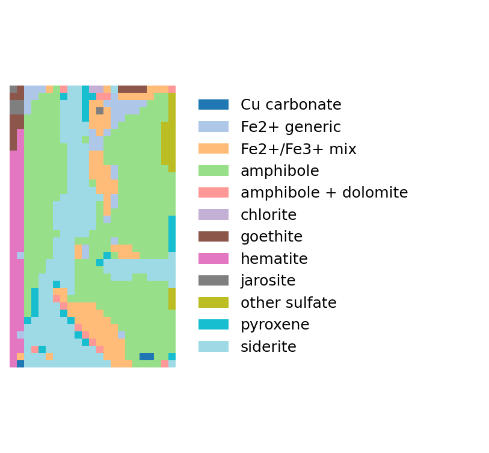

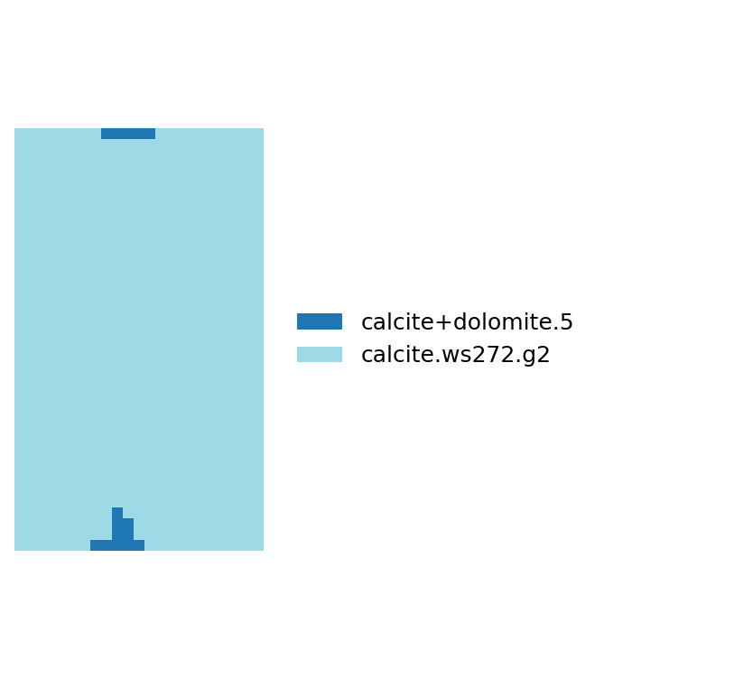

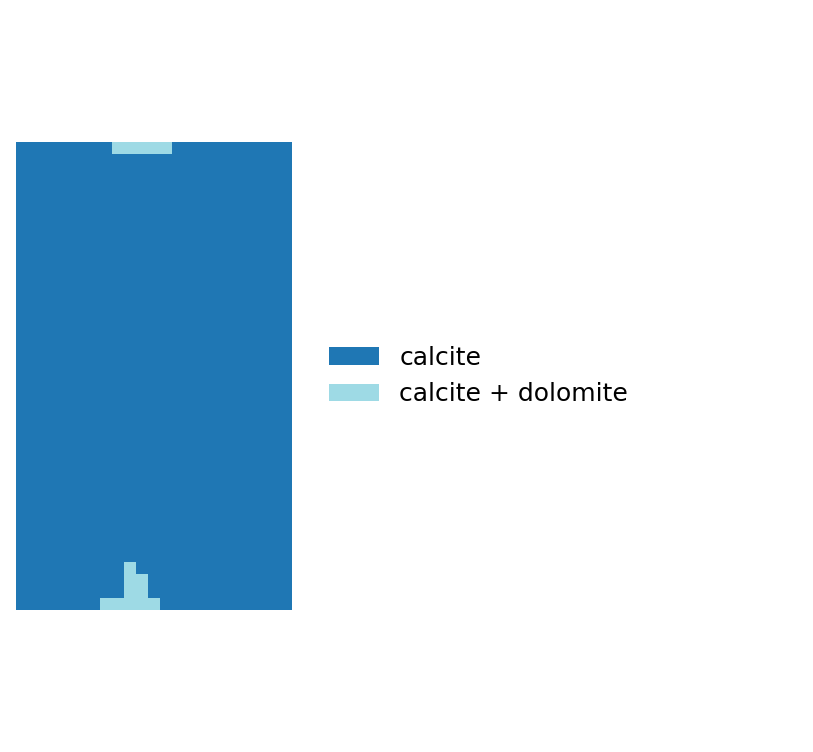

:::
  
#### Freiberg  

::: {layout="[[1, 1], [1, 1]]"}

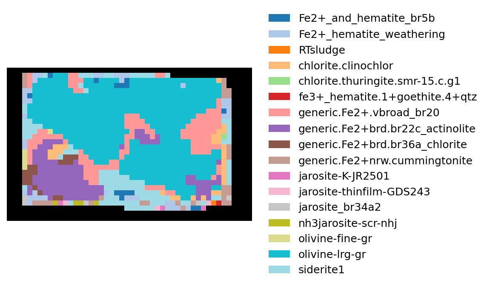

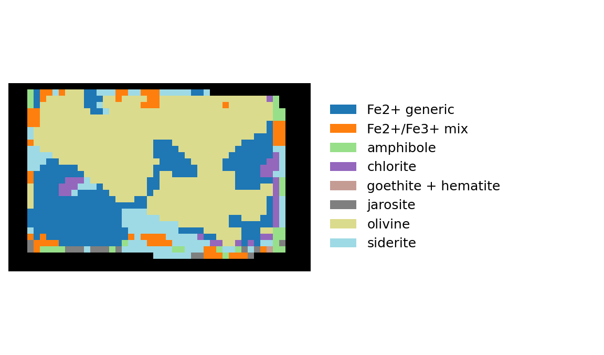

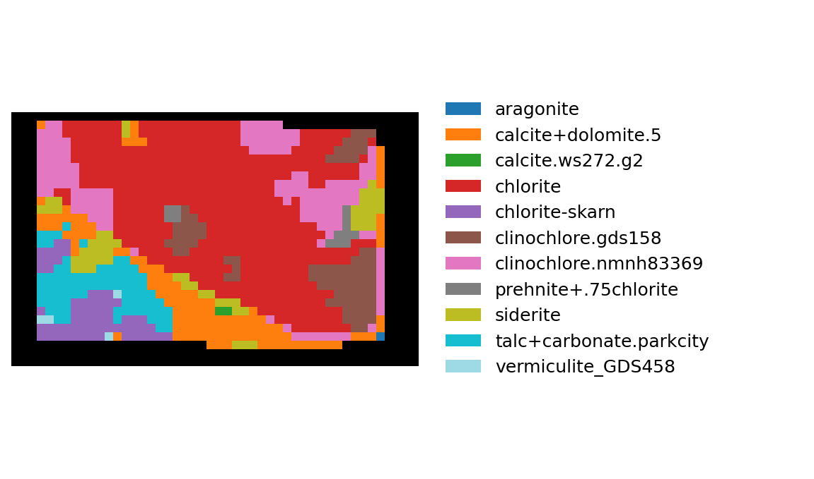

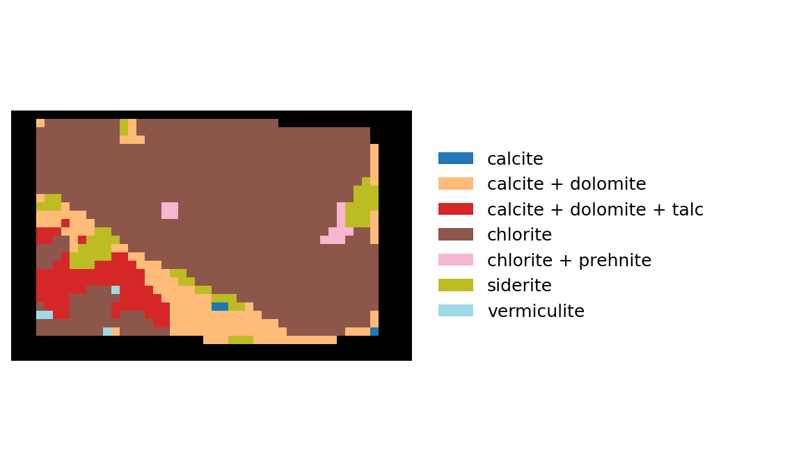

:::
  
#### Bösenbrunn  

::: {layout="[[1, 1], [1, 1]]"}

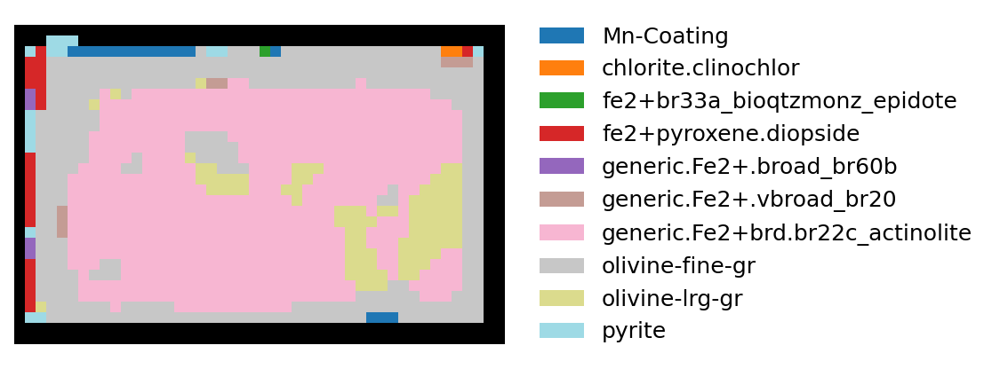

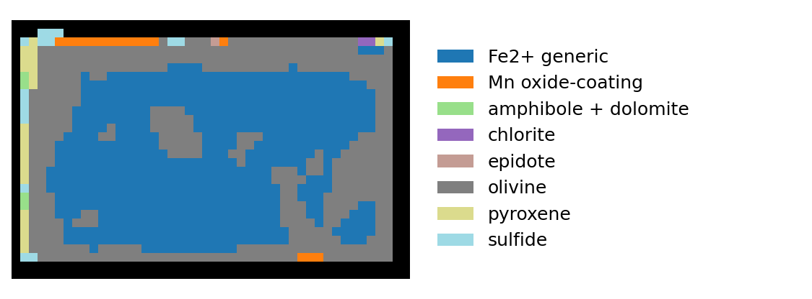

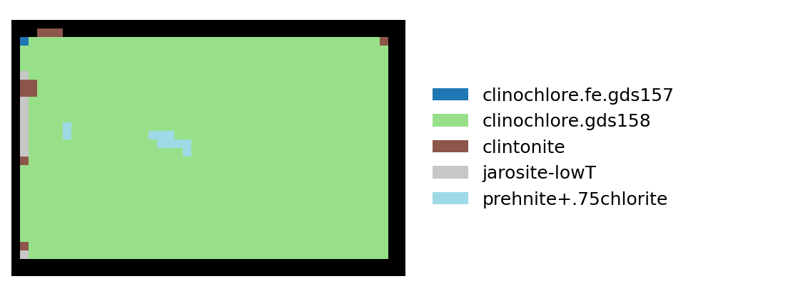

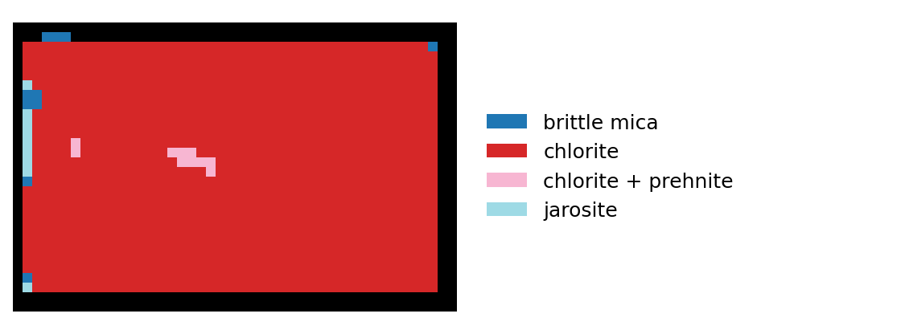

:::  


#### Initial observations  

It is important that I explain the difference between the Tetracorder "Raw winners" 
and the "Core classifications" shown here. The classifications are lookup-based aggregations of the winning rules, 
not a second independent analysis. A class such as `calcite + dolomite` does not necessarily mean that both minerals 
have been independently identified, just that a spectrum measured from mixed material was the best match.  

Additionally the aggregation look-ups are slightly-less-than-arbitrary. I constructed them by grouping rule names and Tetracorder 
"materials" into minerals and mineral families - as such multiple spectral rules can contribute to the same geological class. 
This is also what native Tetracorder does with its rules, I have just built a table specific for core.

The first thing to note is that the maps are not random noise. Across all three samples, Tetracorder produces
spatially coherent classifications, with identifiable domains and boundaries. This is encouraging, although
geological plausibility is only the first hurdle.

**Collinstown** is particularly interesting. Group 2 is remarkably consistent, identifying almost the entire
sample as calcite or calcite + dolomite. Only two spectral rules are responsible for the result. Group 1 
identifies a much more diverse assemblage, dominated by Fe²⁺ rules, siderite and amphibole. The two groups are 
not necessarily contradicting each other: they target different spectral
features and can identify different components of the same assemblage.   
  
**Freiberg** shows a different pattern. Group 1 is dominated by olivine, which seems suspicious, with small regions
of other Fe-bearing minerals. Group 2 is more variable, identifying chlorite, calcite, dolomite and associated mineral
combinations. The result suggests that Tetracorder is recognising a reasonably consistent alteration
assemblage, although we cannot yet say how accurately it represents the measured mineralogy.

**Bösenbrunn** is rather different again. Group 1 produces a substantial variety of iron-related spectral
identifications, particularly those associated with olivine (again, suspicious), iron-bearing minerals and broad Fe²⁺ absorptions.
The broader classification map simplifies this into coherent domains dominated by olivine and Fe²⁺-related classes. 
Group 2, however, is dominated by chlorite, with a small area of chlorite + prehnite.

So, this *looks* pretty good. We are getting coherent and (bar olivine?) reasonable results across 
two spectral domains - although Group 2 is "better" than Group 1 in a geological sense.
  
But is it right? Correct? Accurate? However you want to characterise how much you trust results.  

This is precisely why having independent MLA measurements is valuable. The maps look convincing enough, but
**looking convincing is a very low bar for a mineral classification algorithm**.


## MLA data

The Mineral Liberation Analysis (MLA) provides an independent mineralogical characterisation of each sample.

Unlike the categorical output from Tetracorder, the MLA data are quantitative. 
Each pixel contains estimated abundances for multiple minerals, rather than a single mineral identification.
  
### Dominant mineral maps
We can represent this information in several ways. The simplest is to assign each pixel the mineral with the
highest abundance, producing a dominant mineral map. This provides a useful overview of the mineralogical
distribution, but necessarily conceals any other minerals present.


::: {layout-ncol=3}

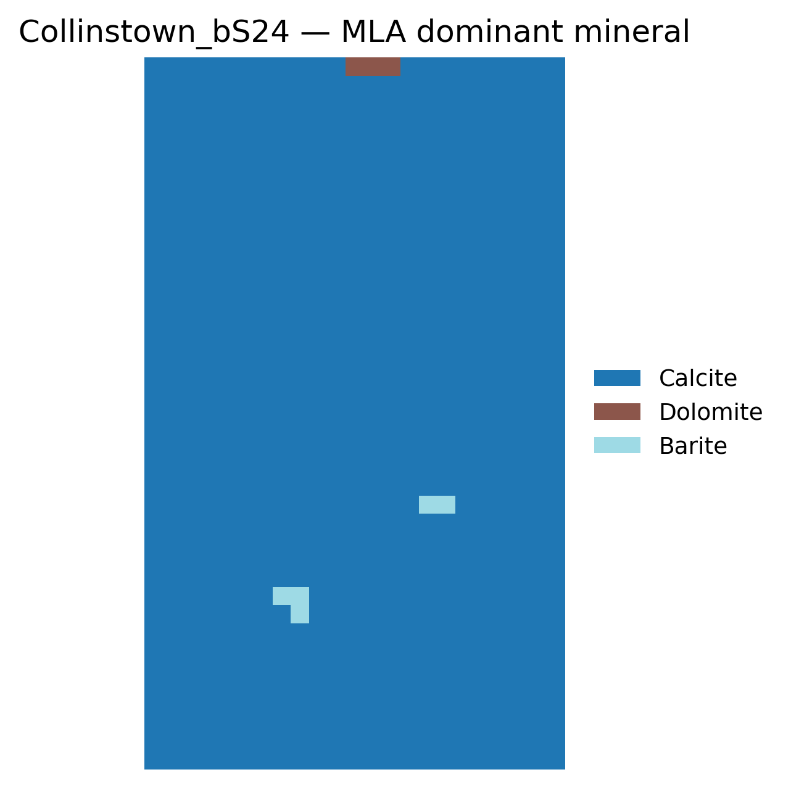

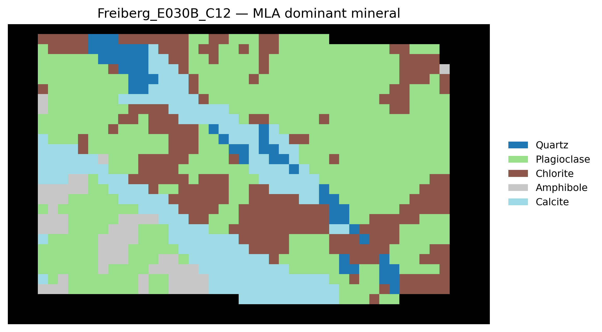

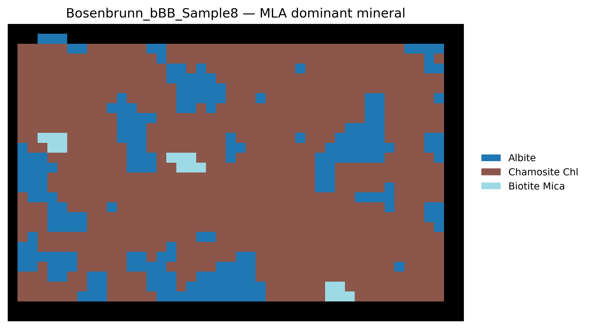
::: 

A cursory examination of the dominant mineral maps is encouraging, particularly for Collinstown and Freiberg.

**Collinstown** is overwhelmingly calcite, with only a few pixels dominated by dolomite or barite. This is
consistent with the strong carbonate response in Tetracorder Group 2. The dolomite-dominated pixels at the top of the
sample also sit where Group 2 identified calcite + dolomite, although the dominant mineral map does not tell us how
much dolomite might be present alongside calcite elsewhere.

**Freiberg** has a much more varied mineralogy, with substantial areas dominated by plagioclase, chlorite and
calcite, alongside smaller areas of quartz and amphibole. The diagonal calcite band follows the carbonate band in
Tetracorder Group 2 closely.

**Bösenbrunn** is dominated by chamosite (an iron-rich chlorite), with small regions of albite and occasional
biotite. This is an interesting result given the apparent prevalence of chlorite in Tetracorder Group 2,
although Group 1's iron-related identifications will warrant closer examination.  

Perhaps unsurprisingly, olivine is not the dominant mineral in either Freiberg or Bösenbrunn!

Plagioclase and albite dominate large parts of Freiberg and Bösenbrunn, but they
have no diagnostic features in the VNIR–SWIR. A pixel that is mostly plagioclase with some chlorite will look like
chlorite to Tetracorder, because chlorite is the only thing in it with an absorption to match. Spectral dominance and
abundance dominance are not the same thing.

So, these are only dominant mineral maps. They tell us which mineral has the greatest abundance at each
pixel. By taking only the dominant mineral we have reduced a quantitative dataset to, effectively, a classification map,
discarding what we actually need to test Tetracorder.

The next step is therefore to examine the actual mineral abundances, which are harder to visualise, but that's where
the real test lies.  
  
### Mineral abundance maps  

*big image dump incoming*  
  
#### Collinstown 


::: {layout-ncol=3 fig-cap="Collinstown: Tetracorder Group 2 classifications compared with MLA calcite and dolomite abundances."}


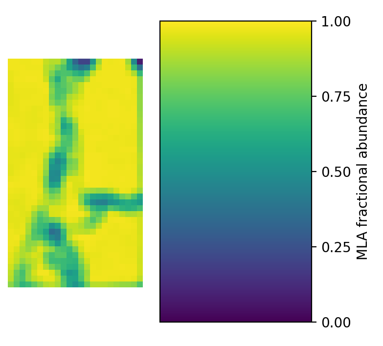

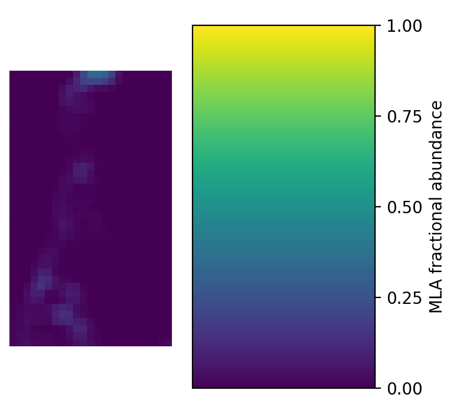
:::  

For Collinstown the only minerals identified by Tetracorder in Group 2 were calcite and dolomite. 
The MLA abundance maps show that calcite is abundant throughout, and that dolomite is locally more abundant at the top
of the sample, exactly where Tetracorder identified the mixture. The calcite + dolomite pixels at the bottom of the
sample have no obvious MLA counterpart, so that is one hit and one miss.
  


The actual mineral abundances in the Collinstown sample are:  

|Mineral|Summed fractional abundance (pixel equivalents)|
|---|---|
|Calcite|794.32|
|Barite|40.36
|Pyrite|12.84
|Dolomite|11.94|
|Quartz|9.51|
|Phengite|8.88|
|etc|etc|
  
::: {layout-ncol=3 fig-cap="Collinstown: Tetracorder Group 1 classifications compared with MLA barite and pyrite abundances."}


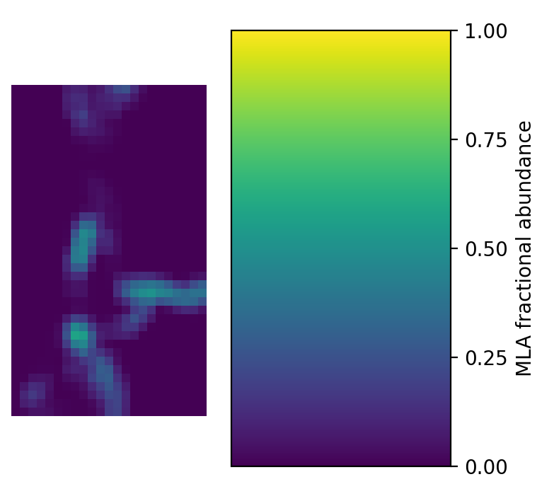

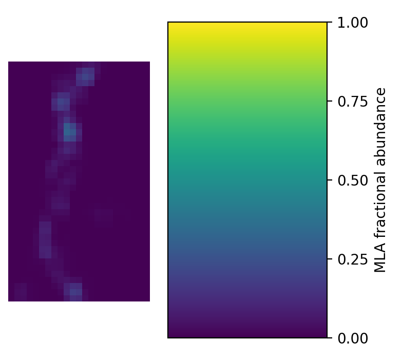
:::
  
In Collinstown, Group 1 found a range of Fe²⁺ responses, but is dominated by two rules: `generic.Fe2+nrw.actinolite` across the calcite
matrix, and `siderite1` along a band running down the sample. That band follows the vein where the MLA has barite,
pyrite and dolomite, and where calcite abundance drops.

Neither mineral is right as named. There is no actinolite or amphibole channel in the Collinstown MLA, so it was
either not present or not set up to be detected. The actinolite rule winning across nearly pure calcite looks like
Group 1 fitting weak Fe²⁺ features (perhaps trace Fe in the calcite) to the closest reference it has.
  
The siderite band is more interesting, because it follows a real mineralogical boundary. There is no siderite channel
in the MLA data. Irish-type dolomite can be ferroan, and Fe²⁺ in a carbonate is exactly what a siderite reference
would match, so it is tempting to say Group 1 is seeing an Fe-bearing carbonate in the vein. But dolomite is only a
small fraction of this sample, and the MLA can't confirm it. (Freiberg, below, is a cautionary tale about exactly this
sort of explanation.)

So Group 1 is separating the matrix from the vein. It is identifying the spatial pattern of the measured mineralogy,
even if it is very wrong about the actual minerals.

#### Freiberg  

::: {layout="[[1, 1], [1, 1]]" fig-cap="Freiberg: Tetracorder Group 2 classifications compared with MLA chlorite, calcite and dolomite abundances."}


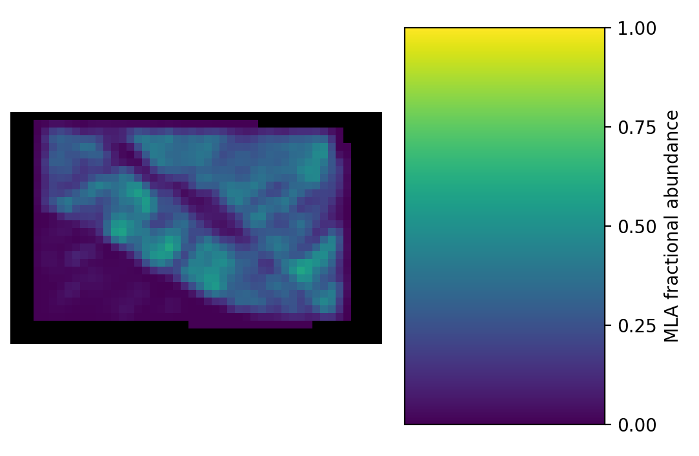

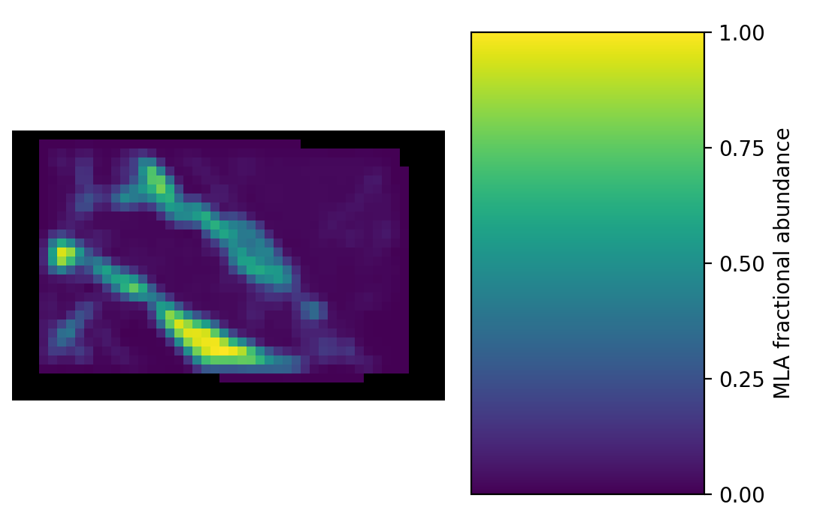

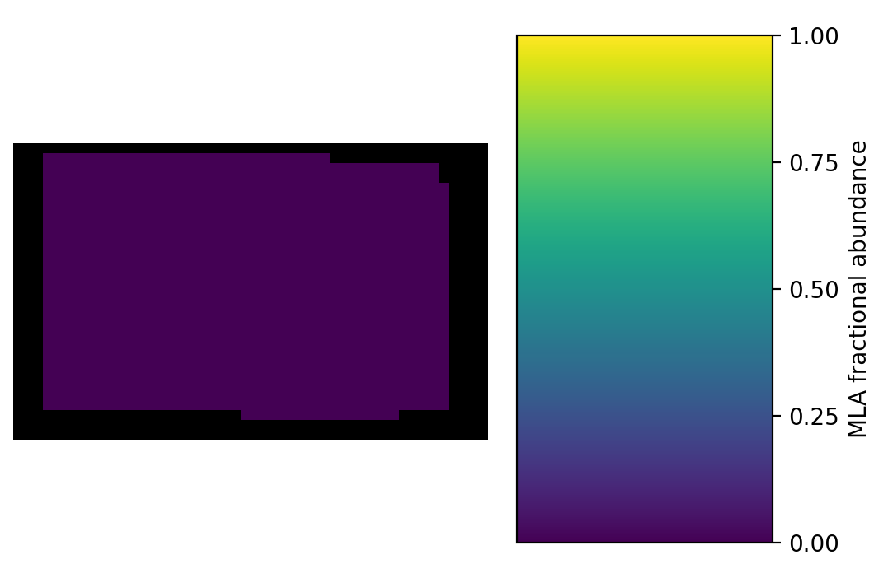
:::  
  
For Freiberg, Tetracorder Group 2 found mostly chlorite, calcite and dolomite (or actually a calcite-dolomite mixture).  
The MLA data shows that calcite and chlorite are in fact abundant in this sample (hooray!), and the spatial pattern of 
the lower calcite vein has been detected nicely by Tetracorder. The upper vein is less clear, but the MLA shows it is 
quartz-rich (below), and quartz has no VNIR–SWIR features to detect, so the carbonate signal there is diluted rather 
than missed.  

The dolomite is a problem, though: the MLA has no dolomite at all. It does have an ankerite channel however, an Fe-bearing
dolomite-group carbonate, which could plausibly sit spectrally between the calcite and
dolomite references. 

::: {layout-ncol=3 fig-cap="Freiberg: Tetracorder Group 1 and 2 classifications compared with MLA Ankerite abundances."}


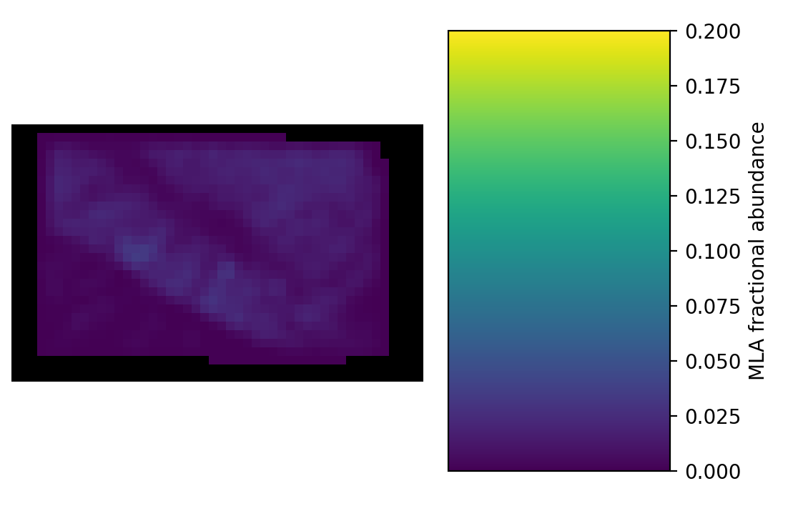


::: 

But it doesn't hold up. The ankerite is low in abundance (note the stretch: the maximum is 0.2) and spread through the
matrix, not concentrated in the calcite vein. So the `calcite+dolomite.5` match remains unexplained. One alternative is
mixing with chlorite: calcite's main absorption is near 2.34 µm, dolomite's near 2.32 µm, and chlorite has a Mg-OH
feature around 2.33 µm, so a calcite–chlorite mixture could pull the apparent carbonate feature towards a
calcite–dolomite intermediate. That is one to test properly rather than assert.

Group 1 also has `siderite1` winners along the lower calcite vein, despite the MLA reporting almost no siderite. 
Group 1 is picking out the carbonate vein from the matrix, but not naming it correctly.  

::: {layout-ncol=2 fig-cap="Freiberg: Tetracorder Group 1 classifications compared with MLA amphibole abundances."}


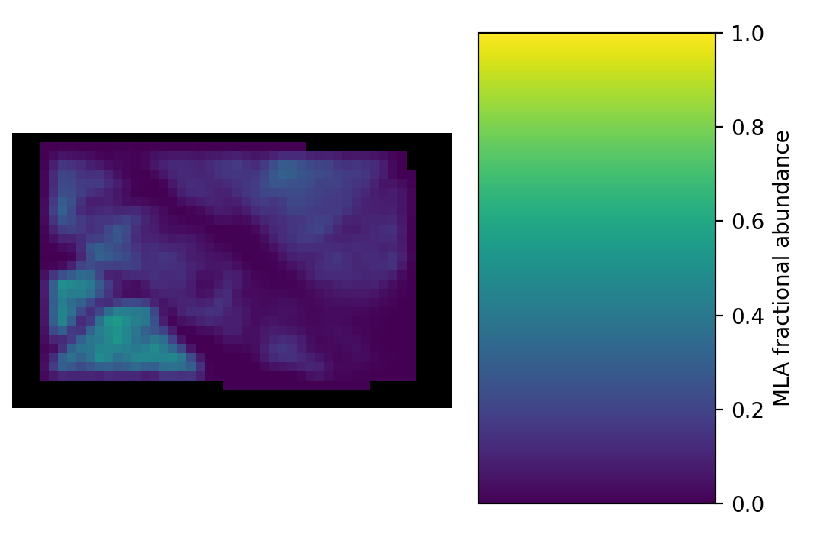

::: 

Group 1 Tetracorder winners were dominated by olivine and actinolite. Unsurprisingly there was no olivine channel in
the MLA data. There is no actinolite channel either, but the amphibole channel is the appropriate comparison, 
and here Tetracorder does well: the actinolite winners in the lower left sit on the highest MLA amphibole abundances.  

The actual mineral abundances in the Freiberg sample are:  

|Mineral|Summed fractional abundance (pixel equivalents)|
|---|---|
|Plagioclase|281.44|
|Chlorite|198.28|
|Calcite|135.11|
|Amphibole|117.31|
|Quartz|65.69|
|Epidote|28.45|
|etc|etc|


::: {layout="[[1, 1], [1, 1]]" fig-cap="Freiberg: Tetracorder Group 1 classifications compared with MLA abundant minerals"}


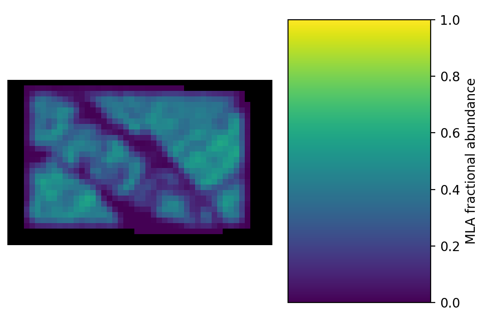

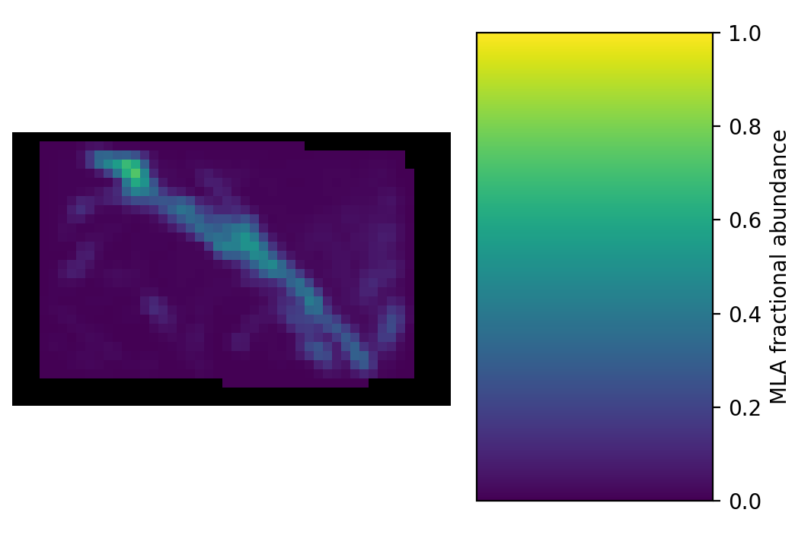

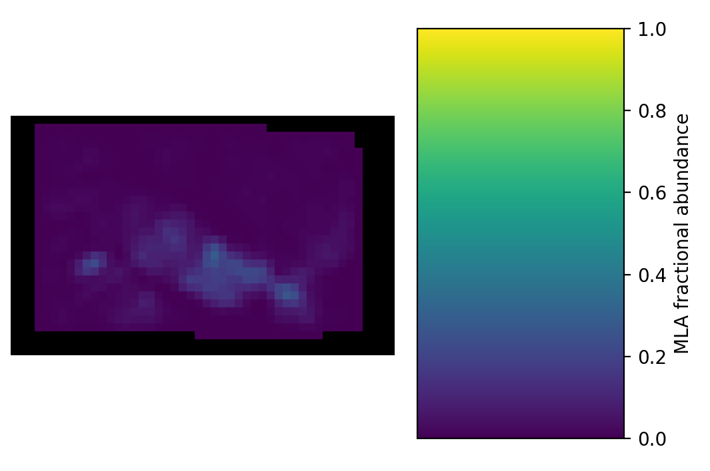
::: 

It is clear that plagioclase dominates this sample, with some quartz. These minerals do not have significant features in the 
spectral ranges covered by Tetracorder. Tetracorder is instead detecting the lower abundance VNIR-SWIR active minerals 
present in these pixels and getting it partly right and partly confused. 
Epidote and chlorite share absorptions near 2.25 and 2.34 µm, so the
epidote is probably being absorbed into the chlorite identifications.  
  
The olivine is the clearest failure. It covers the upper part of the sample, where the MLA has plagioclase with
chlorite and amphibole. The broad ~1 µm Fe²⁺ absorption from those minerals is plausibly, but incorrectly, 
being matched to an olivine reference.  
  
#### Bösenbrunn  
  
::: {layout-ncol=3 fig-cap="Bösenbrunn: Tetracorder Group 2 classifications compared with MLA chlorite and prehnite abundances."}


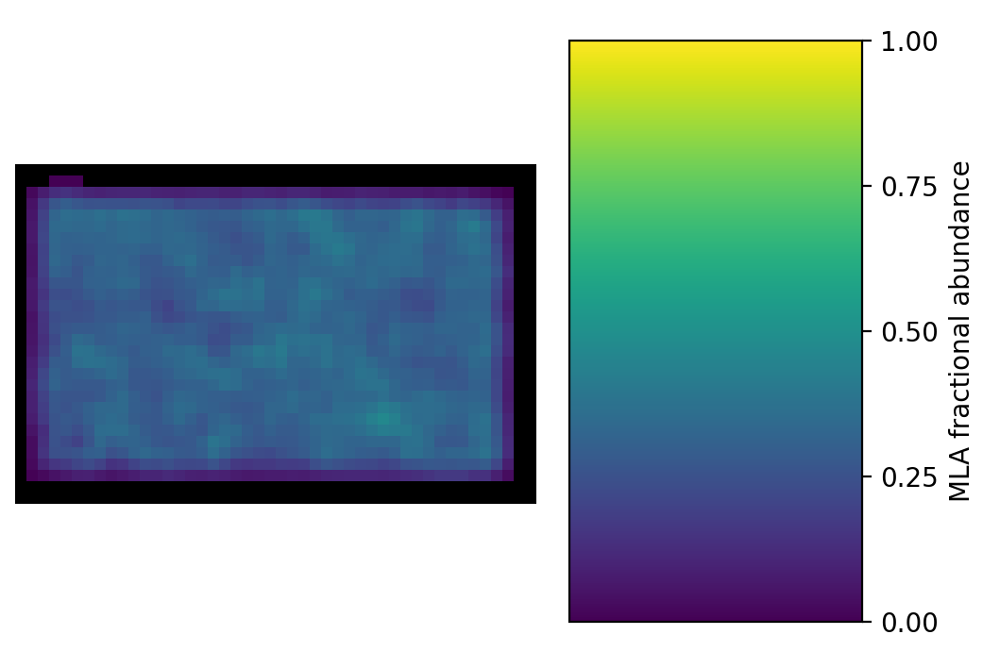

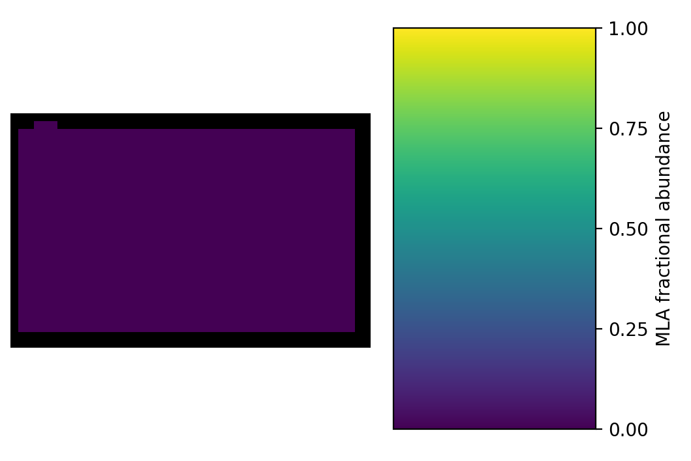
:::    
  
For Bösenbrunn Tetracorder Group 2 detected chlorite and a mixture of chlorite + prehnite.  
The MLA shows that there is chlorite. Yay? Prehnite is really negligible in this sample, suggesting that the chlorite +
prehnite match is Tetracorder's best fit for some other mixture.
  
::: {layout-ncol=2 fig-cap="Bösenbrunn: Tetracorder Group 1 classifications compared with MLA actinolite abundances."}


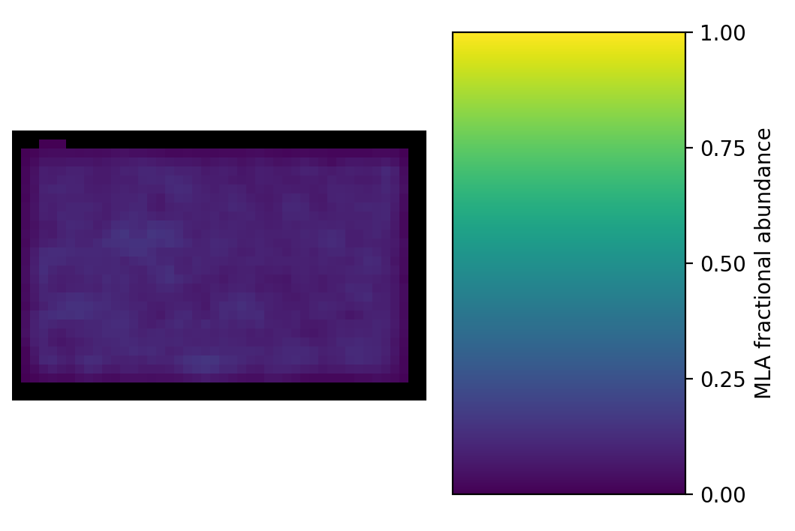

::: 
  
Tetracorder Group 1 detected actinolite and olivine. Once again, the MLA did not have an olivine channel 
but it did have a specific actinolite channel. Actinolite is relatively low in abundance (around 10%), 
but it is present across most of the sample.
  
That makes the actinolite identification look reasonable, but I would call it unresolved rather than a hit.
The dominant mineral is chamosite, an Fe-rich chlorite, which also has a strong Fe²⁺ absorption, so the Group 1 
may be naming actinolite what is in fact chlorite, even though it has chlorite references available.  
  
The actual mineral abundances in the Bösenbrunn sample are:  

|Mineral|Summed fractional abundance (pixel equivalents)|
|---|---|
|Chamosite Chl (Chlorite map above)|311.58|
|Albite|244.96|
|Biotite Mica|104.35|
|Titanite|97.78|
|Actinolite AM|96.30|
|Quartz|66.26|
|etc|etc|
  
::: {layout="[[1, 1], [1, 1]]" fig-cap="Bösenbrunn: Tetracorder Group 1 classifications compared with MLA abundant minerals"}


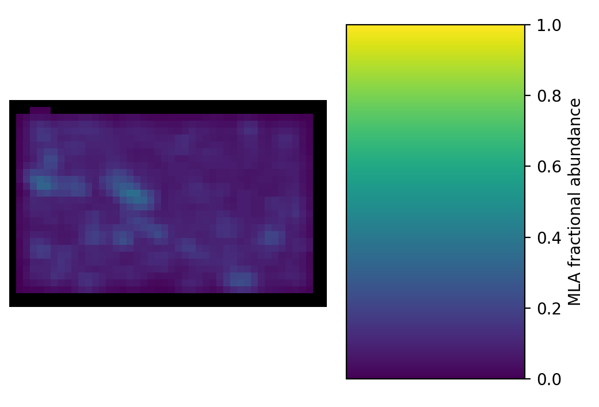

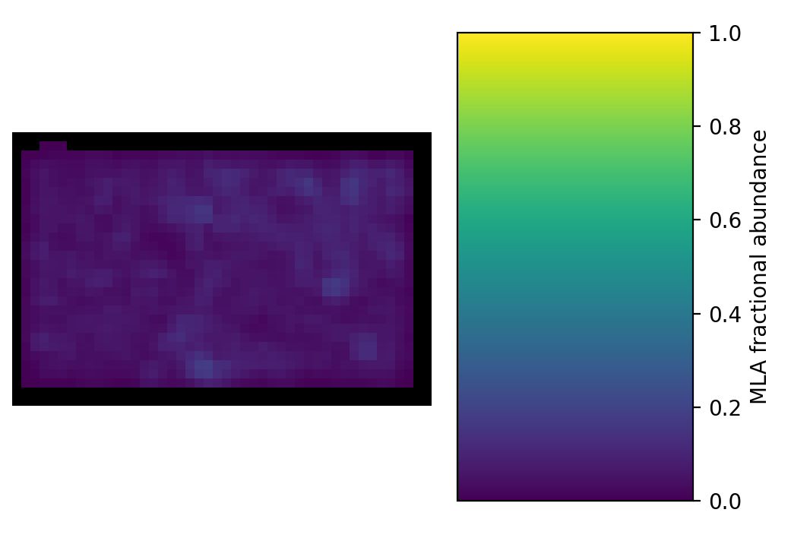
::: 
  
Much of the Bösenbrunn mineralogy is made up of minerals that I would not expect Tetracorder to detect at all.

## So, how good is it?  
  
On three samples, the honest answer is "better than I expected, in some ways, and for some of the right reasons".

The SWIR rules (Group 2) found the right spectrally active mineral in all three samples: calcite in Collinstown,
chlorite and carbonate in Freiberg, and chlorite in Bösenbrunn. In Collinstown and Freiberg, they also put the
carbonate in roughly the right place.

The VNIR Fe rules (Group 1) are much less reliable as mineral identifications. Olivine wins large areas of two samples
that contain none, and actinolite wins across a nearly pure calcite. But Group 1 is not useless: its spatial patterns
follow real mineralogical boundaries, and in both Collinstown and Freiberg the siderite winners pick out the carbonate
veins from the matrix, even though the MLA has essentially no siderite.

Across all three samples, a large fraction of the rock (plagioclase, albite, quartz) is invisible in the VNIR–SWIR.
Tetracorder is identifying the minor, spectrally active phases in an otherwise spectrally neutral matrix, and any
fair evaluation has to account for that.

Obviously, this is very subjective! All of this looking between mineral maps and comparing spatial
patterns is really fun, but what I need is an objective evaluation of Tetracorder's performance against the full
ground-truth dataset. That needs some care: Tetracorder classes have to be mapped onto MLA channels (and some
channels, like olivine, don't exist), the evaluation should be restricted to SWIR-active minerals, and I need to decide
how much of a mineral the MLA must report before Tetracorder "should" see it.  
  
Also, I have looked at 3 samples, from a 200+ benchmark dataset. For a blog post.

That's Part 2. An objective, scientifically rigorous (or close enough for a blog) 
evaluation against the full benchmark dataset.  

Some hypotheses to test (you *could* call them conclusions from Part 1):

1. **Group 2 correctly identifies the dominant SWIR-active mineral.**
2. **Group 1 Fe²⁺ rules over-call olivine and possibly actinolite** where the Fe²⁺ actually comes from chlorite or carbonate. This 
assumes that the absence of an olivine channel in MLA is actually absence of olivine.
3. **Mixed-carbonate classes do not reliably indicate a second carbonate.** In Collinstown the calcite + dolomite
   match partly coincides with real dolomite; in Freiberg there is no dolomite, and mixing with chlorite is a candidate
   explanation.
4. **Tetracorder detects SWIR-active minerals at low abundance in spectrally neutral matrices.** The question is how
   low.  


