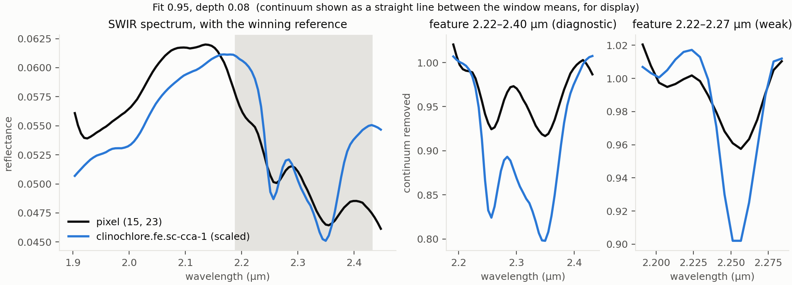
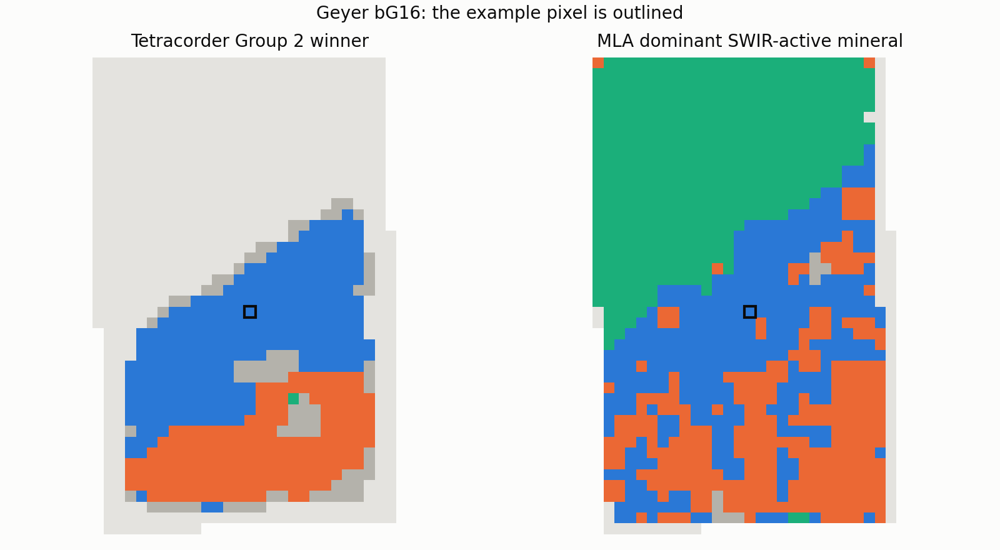
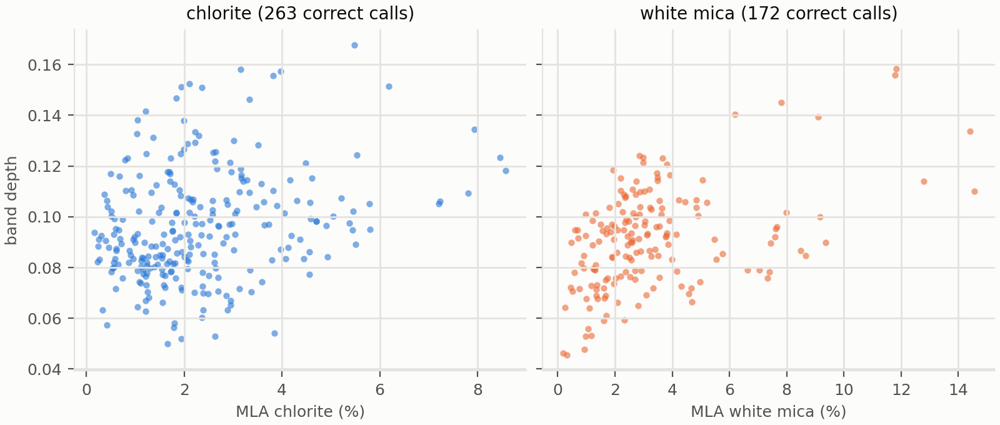
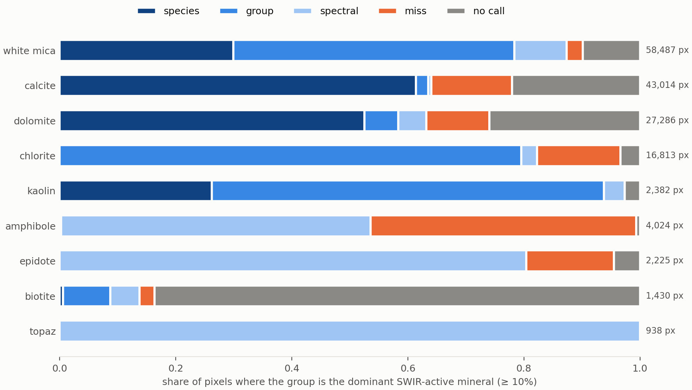

Just like [Part 1](tet-good-or-not.qmd), this note draws heavily on the expertise of Thiele *et al.*, not just their [Benchmark Dataset](https://rodare.hzdr.de/record/4582), but also the methodology from their [accompanying paper](https://www.mdpi.com/2075-163X/16/7/674).


I ended Part 1 with some "Conclusions" or "Hypotheses". After giving it 
some thought I have re-worked what I actually want to test:

1. Tetracorder Group 2's winner is the most abundant SWIR-active mineral.
2. Tetracorder detects SWIR-active minerals reliably:
    a. even at low abundance, in spectrally neutral matrices;
    b. and the mineral it names is present, even when it isn't the most abundant SWIR-active mineral.
3. Tetracorder's metrics track with mineral abundance.  

I have decided not to test Group 1 winners here. Although the benchmark dataset does cover the same range as the Group 1 rules, *my* data 
does not, and I want to test Tetracorder for SWIR only instruments. 

I will also only perform comparisons on the raw winners Tetracorder produces, not on my post-processing aggregations - these are still preliminary and will hopefully be informed by this work. 

And one final caveat: all of the references to Tetracorder results in this note refer to results produced using [python-tetracorder](https://github.com/Russjas/python-tetracorder) and not the authoritative release of [Tetracorder](https://github.com/PSI-edu/spectroscopy-tetracorder). While I went to [significant effort](https://github.com/Russjas/python-tetracorder#fidelity) to reproduce the behaviour of the native code faithfully - this is *not* the native code.

## Methodology  
  
### Anatomy of a python-tetracorder run

Unlike classic Tetracorder, python-tetracorder stores the winners and float values of the winner's characteristics as ndarrays, rather than streaming 8-bit rasters to disk.  

So for some context, here are some of the raw outputs from Tetracorder run 4 - the true SWIR run.

```python
from tetracorderp import GroupEvaluator

# an existing run saved to npz can be re-materialised 
run = GroupEvaluator.from_npz("path/to/run4_sg11-2_g2_trueswir/Geyer_bG16_tetracorder.npz")
print(run.group_winners.keys())
#dict_keys([2]) run.group_winners a dictionary of all of the data for the groups analysed
print(run.group_winners[2].keys())
#dict_keys(['winner', 'fit', 'depth', 'fit_depth'])
winners = run.group_winners[2]["winner"]
fit = run.group_winners[2]["fit"]
depth = run.group_winners[2]["depth"]
fit_depth = run.group_winners[2]["fit_depth"]

print(winners.shape, winners.dtype)
#(31, 45) object

print("Pixel winner: ", winners[15, 23])
print("Winner's fit: ",fit[15, 23])
#Pixel winner:  clinochlore.fe.sc-cca-1
#Winner's fit:  0.9536203
```

{fig-align="center" width=90%}  
  
Tetracorder called this pixel `clinochlore.fe.sc-cca-1`, a member of the chlorite mineral group. Figure 1 shows the spectrum of the pixel and the spectrum of the winning reference (left), and the spectral windows that this rule assesses on this reference (centre and right).  

So, Tetracorder provides a rich dataset, with the classification and the corresponding values for each winner.

### Anatomy of an MLA dataset  
  
The MLA data are stored as ENVI files, indexed by the hycore hyShed system. A few of the MLA files don’t open cleanly through hycore, so I read the ENVI files directly with Spectral Python.  

```python
from pathlib import Path
import numpy as np
import hycore
from spectral.io import envi

hole_name = "Geyer" 
sample_name = "bG16"

shed_path = Path("path/to/Helmholtz_benchmark/MLA/MLA.shed")

shed = hycore.loadShed(shed_path)
boxes = shed.getBoxes()
box = shed.getHole(hole_name).getBox(sample_name)
mla_path = (shed_path / f"{box.holeName()}.hyc"/ f"{box.name}.hyc" / "MLA_HSI.hdr")
mla_img = envi.open(str(mla_path))
mineral_channels = [n.strip() for n in mla_img.metadata["band names"]]
mla = np.asarray(mla_img.load(), dtype=np.float32).transpose(1, 0, 2)  # ENVI -> hylite (x, y)  
print("mla shape: ", mla.shape)
print("number of mineral channels: ", len(mineral_channels))
#mla shape:  (31, 45, 70)
#number of mineral channels:  70
print(mla[15, 23])
#[0.3669482  0.18056996 0.01277622 ... ...]
print("Most abundant mineral in pixel: ", mineral_channels[np.argmax(mla[15,23])])
#Most abundant mineral in pixel:  Quartz
PRESENT = 0.001                                           # Arbitrary presence threshold
present_mins = {mineral: round(float(ab), 3) for mineral, ab in zip(mineral_channels, mla[15, 23]) if ab > PRESENT}
for mineral, abundance in present_mins.items():
  print(mineral, abundance)
#Quartz 0.398
#Albite 0.248
#K-feldspar 0.332
#Chamosite Chl 0.012
#Muscovite Mica 0.008
#Apatite 0.001
```
{fig-align="center" width=90%}   

In the single pixel code above, Tetracorder decided it was clinochlore.fe.sc-cca-1, while the MLA shows that the pixel is dominated by quartz and feldspar. Tetracorder is never going to report quartz and feldspar - they are simply not active in the SWIR range. So, we need to compare Tetracorder with SWIR-active minerals only (as in Figure 2).  
  
In the example pixel, the SWIR-active minerals in the MLA are chamosite and muscovite - so Tetracorder's clinochlore is wrong. But is it *completely* wrong? Well, no, not completely. It has identified the mineral species incorrectly, but it has recognised that there is a chlorite there.  
  
### A hierarchy of apples to compare  

So, how can you systematically compare a Tetracorder winner of the form `clinochlore.fe.sc-cca-1` with MLA channels of the form `Chamosite` or `Muscovite Mica`? String matching, partial string matching or regex seem doomed to failure (as well as being no fun at all). We need to define a common vocabulary between the two datasets.

Mineral names come in levels, and neither dataset sticks to one level.

The spectral group is the level that SWIR spectroscopy actually sees. Tetracorder identifies an absorption, the features
near 2.25 and 2.33 µm, then names the reference spectrum that best matches it. Getting the spectral group right means
Tetracorder found the right kind of absorption. Getting the mineral group right means it matched the right family of
reference spectra. Getting the species right means the fine detail of the feature, such as its exact position as Fe
replaces Mg in a chlorite, also lined up.

The spectral group is not a neat layer above the mineral group. Most chlorites absorb at Fe/Mg-OH, but cookeite, a
Li-Al chlorite, absorbs at Al-OH. So every species has exactly one mineral group and (for the purposes of this comparison) exactly one spectral group, and the two are treated as separate labels rather than a strict tree.

The MLA reports chamosite and clinochlore as species in some samples, but just "Chlorite" at
another. Among the smectites it only reports nontronite. Tetracorder has species-level references, such as
`clinochlore.fe.sc-cca-1`, alongside generic ones like `chlorite`, and mixtures such as `muscovite+chlorite`. So
every MLA channel and every Tetracorder rule is mapped to all three levels, and a comparison can only be as fine as the
coarser of the two sides. A generic "Chlorite" MLA channel can never produce a species match.

Each pixel gets the single finest level at which the two agree:

1. *Species*: the same mineral.
2. *Group*: a different species in the same mineral group.
3. *Spectral*: a different mineral group with the same absorbing bond.
4. *Miss*: none of the above.

Tetracorder can also return no winner at all and those are
counted separately. A mixture rule counts as a match if any of its components matches.

Back to the example pixel: the MLA's dominant SWIR-active mineral is chamosite, an Fe chlorite. Tetracorder called an
Fe-rich clinochlore, which sits next to chamosite on the same Mg–Fe solid solution. That is a *group* match.
Tetracorder didn't name the right species, but it found the right absorption and the right mineral family.  
  
So, to compare apples with apples, I need to define the mappings:  
  
Tetracorder winning rule <--> Common species/group/spectral vocabulary <--> MLA channel
  
For our example pixel:  

Tetracorder rule → common vocabulary:

| rule | species | mineral group | spectral group |
|---|---|---|---|
| clinochlore.fe.sc-cca-1 | clinochlore | chlorite | Fe/Mg-OH |

MLA channel → common vocabulary:

| MLA channel | species | mineral group | spectral group |
|---|---|---|---|
| Chamosite Chl | chamosite | chlorite | Fe/Mg-OH |

Species differ, mineral group agrees, this pixel is a group match.
  
### Constructing the lookups

Tetracorder has 213 rules that can produce a Group 2 result: 200 Group 2 rules,
plus 13 case 6 rules that a Group 2 winner can hand over to (the calcite, epidote and chrysotile rules trigger case 6).
Each rule lists the material, or materials, its reference spectrum represents, in
[`RULE_LOOKUP_MATERIAL`](https://github.com/Russjas/python-tetracorder/blob/ef7f4745089c9b52ef0af5d2f95d8e51516b736c/tetracorderp/resources/postprocessing_lookups.json#L1216).
Every material was assigned a species, mineral group and spectral group by hand. Where a rule's material is only
generic (chlorite, for example), the species is left blank, so that rule can never score a species match.

64 rules are mixtures of two to four materials, such as muscovite+chlorite or prehnite+.75chlorite. Mixtures are kept
as one row per component, and a mixture counts as a match if any of its components matches.

The MLA has 121 distinct channel names, pooled over all 204 samples. Many are duplicates created by site naming:
chamosite appears as "Chamosite", "Chamosite Chl" and "FeChlorite", depending on the site. Each channel was mapped to
the same three levels, giving 14 species reported under more than one name. Where a channel only names a group, as
"Chlorite" does at one site, its species is left blank. 44 of the 121 channels are SWIR-active (Al-OH, Fe/Mg-OH, CO3
or H2O). The other 77 are SWIR-inactive (quartz, feldspars, sulphides, oxides and so on) or aren't minerals at all
(Porosity, Unknown and Other).

#### Thiele *et al.* 2026 lookups

To score Tetracorder the same way the benchmark scores its models, both lookups also carry the paper's group. These
are the 22 mineral groups from the benchmark's own data preparation notebook (`Code/1_DataPrep.ipynb`), whose thesaurus
merges MLA channels into groups (chloritoid into chlorite, siderite into ankerite, and so on) and ignores Porosity,
Unknown, Other and cassiterite. 72 of the 121 MLA channels fall into one of the 22 groups.

On the Tetracorder side, each rule component was assigned whichever of the 22 groups the paper would (presumably) file it under.
White micas follow the paper's split into muscovite, illite and lepidolite, siderite goes to ankerite, and all
sulphates go to sulphate. 83 rules name nothing in the 22 groups (smectites, prehnite, serpentine, talc and so on). A
pixel won by one of them predicts none of the 22, so in the paper's scheme it can miss what's there, but never score a
hit or a false positive.

The resulting lookups can be examined:

[Tetracorder mapping](https://github.com/Russjas/russjas.github.io/blob/main/notes/tetracorder_part2_writeup/group2_crosswalk_long.csv)  
[MLA mapping](https://github.com/Russjas/russjas.github.io/blob/main/notes/tetracorder_part2_writeup/mla_channels.csv)

If you feel strongly enough to thoroughly read the lookups, *and* don't agree with them, then I really, really want to
hear about what I got wrong!

#### Using the lookups

In code, the two lookups do one job each. The Tetracorder lookup takes a winning rule and returns every species,
mineral group and spectral group it names: one row for a single-material rule, several for a mixture. The MLA lookup
takes a channel name and returns its single species, mineral group and spectral group. The cell below loads both, then
puts the example pixel through them, so the two tables in the previous section are now computed rather than typed.

It also defines `match_level`, the rule from the previous section in code form: check species, then mineral group,
then spectral group, and return the first level at which the winner and the MLA channel agree. A blank on the MLA side,
such as the species of a generic "Chlorite" channel, can never match, so a comparison is never finer than its coarser
side.

```python
import pandas as pd

SWIR_ACTIVE = {"Al-OH", "Fe/Mg-OH", "CO3", "H2O"}                # spectral groups with a SWIR absorption
VOCAB = ["species", "group", "spectral_group"]                   # the three levels of the common vocabulary

rule_lookup = pd.read_csv("path/to/group2_crosswalk_long.csv", keep_default_na=False)
mla_lookup = pd.read_csv("path/to/mla_channels.csv", keep_default_na=False).set_index("mla_channel")

# Tetracorder side: the example pixel's winner, and everything it names (a mixture names several)
rule = winners[15, 23]
tet_sets = {level: set(rule_lookup.loc[rule_lookup["rule_id"] == rule, level]) - {""} for level in VOCAB}
print(rule, tet_sets)
#clinochlore.fe.sc-cca-1 {'species': {'clinochlore'}, 'group': {'chlorite'}, 'spectral_group': {'Fe/Mg-OH'}}

# MLA side: the example pixel's most abundant SWIR-active channel
pixel = pd.Series(mla[15, 23], index=mineral_channels).fillna(0)
active = pixel[mla_lookup.loc[pixel.index, "spectral_group"].isin(SWIR_ACTIVE)]
channel = active.idxmax()
truth = mla_lookup.loc[channel, VOCAB]
print(channel, round(active.max(), 3), truth.to_dict())
#Chamosite Chl 0.012 {'species': 'chamosite', 'group': 'chlorite', 'spectral_group': 'Fe/Mg-OH'}


# the finest level at which a winner and an MLA channel agree
def match_level(tet_sets, truth):
    for level, name in zip(VOCAB, ["species", "group", "spectral"]):
        if truth[level] != "" and truth[level] in tet_sets[level]:
            return name
    return "miss"


print(match_level(tet_sets, truth))
#group
```

Different species, same mineral group: the example pixel is a group match, as worked out by hand above.

### Tetracorder runs

All runs were made with a single script, [Tet_run_script.py](https://github.com/Russjas/russjas.github.io/blob/main/notes/tetracorder_part2_writeup/Tet_run_script.py),
which writes each run to its own folder alongside a `run_settings.json` recording exactly how it was made.

Every run starts from the same FENIX reflectance cubes, with the first and last 10 bands dropped as noisy (from the pre-processing methodology of Thiele *et al.*), leaving 412–2448 nm. Pixels with any missing band are masked. Each run then varies one thing:

| Run | Savitzky–Golay window | Order | Enabled groups | Bands used |
|---|---|---|---|---|
| 1 | 11 | 2 | 1 and 2 | full range |
| 2 | 11 | 2 | 2 | full range |
| 3 | 5 | 1 | 2 | full range |
| 4 | 11 | 2 | 2 | SWIR only, 970 nm and above |

Smoothing (runs 2 and 3). In Part 1, I suggested that Savitzky–Golay smoothing with a window of 11 and a
second-order polynomial suits Tetracorder best, while Thiele *et al.* used 5 and 1. Runs 2 and 3 differ only in this.

Group 1 (runs 1 and 2). I said at the start that comparisons are confined to Group 2, the group that matters for
my own data. But some Group 1 rules act as NOT vetoes on Group 2 rules (calcite is vetoed by a Group 1 chlorite +
muscovite reference, for example), and the benchmark's FENIX data cover Group 1's range. Run 1 enables Group 1 so its
effect on Group 2 can be measured; Group 1's own results aren't compared.

True SWIR (run 4). The FENIX covers the VNIR and the SWIR, but a SWIR-only instrument doesn't. Run 4 uses only
the bands from the SWIR detector, which starts at 974 nm. The VNIR bands are passed to Tetracorder as invalid, so any
feature or continuum window below 970 nm is out of range, and the smoothing is applied to the SWIR bands only, so the
window never straddles the join between the two detectors. Group 2 rules that rely on a VNIR feature, such as
siderite's broad Fe²⁺ absorption, can't be called. This is the run closest to scanning core with a SWIR camera.

All runs use Tetracorder's default thresholds (`mode="default"`), room temperature (288–298 K), and case 6, which a
Group 2 winner can hand over to. Group 0 normally competes in Group 2, and it is enabled, but every one of its rules is
among the disabled materials below, so it never wins.

#### Disabled materials

Separately from whole groups, individual rules can be switched off by passing a list of rule ids to the run. The list
for these runs comes from [core_lookups.json](https://github.com/Russjas/russjas.github.io/blob/main/notes/tetracorder_part2_writeup/core_lookups.json),
the lookup I use to map every Tetracorder rule onto a core-logging class. In that lookup, every rule whose reference
isn't a geological material is tagged `non-geo`: vegetation, liquid water, snow and ice, plastics, paints, fibreglass,
hydrocarbons, cyanides and the World Trade Center dust and debris references. Portlandite (cement) and brucite are
tagged `non-geo` too. Brucite is a real mineral, but on core it only ever fitted noise and water-band wiggles. None of
these has any business winning on drill core, so all `non-geo` rules are disabled. While the full use of that
particular lookup to classify core is preliminary, I am confident in the classifications of `non-geo`.

Five more rules are disabled by name. `chalcedony` and `hydrated_basaltic_glass` are broad, single-feature references
with no NOT vetoes, so they fit almost any broad 2.2 µm or water absorption and win pixels they have no real claim to.
They misbehave. `azurite.ws316.g2`, `malachite.hs254.3b.g2` and `nontronite.ng-1.a.g2` rely on VNIR features that a
SWIR-only instrument can't see, so they would be judged, poorly, on half their evidence. They are disabled in every run, so the
runs differ only in the settings in the table.

A disabled rule is never evaluated, so any NOT veto that uses it never fires. This is native Tetracorder behaviour,
and here it's what I want. 44 Group 2 rules carry a veto sourced from a `non-geo` rule, almost all from
`white_pvc_pipe`, `dryveg.grass.long` or `vegetation1`, including the whole chlorite, amphibole, serpentine and talc
families. Those vetoes exist to stop Mg-OH rules winning on plastic and dry vegetation. Drill core carries neither, so
on core any of those vetoes firing could only be a false veto.

## Hypothesis testing

We have now defined what a Tetracorder run looks like, what the MLA data look like, and a common vocabulary to compare
the two. All that remains is to actually compare them.

Each hypothesis is tested below on the example sample, Geyer bG16. (The full single sample example can be run from [this script](https://github.com/Russjas/russjas.github.io/blob/main/notes/tetracorder_part2_writeup/write_up_cells.py)). The cells pick up the `winners`, `fit`, `depth`,
`mla` and `mineral_channels` loaded earlier. Every comparison is made pixel by pixel. A pixel is used if the MLA has
data there and it isn't entirely porosity, unknown or other (those three together under 70%).  

The same operations were then run over all 204 samples and every Tetracorder run, using
[this code](https://github.com/Russjas/russjas.github.io/blob/main/notes/tetracorder_part2_writeup/common_vocab.py),
and those results are in the next section.

### H1: is Group 2's winner the most abundant SWIR-active mineral?

For each pixel, I take the most abundant *SWIR-active* MLA channel (the dominant mineral in the code block) and compare it with
Tetracorder's winner, using the lookups to put both into the common vocabulary. This is the most abundant channel,
not the most abundant mineral group. Channels are what carry the species, so species matches need them. The cost is
that a pixel with 8% chamosite and 7% clinochlore holds 15% chlorite, yet no single channel reaches the 10% threshold
below, so the pixel isn't counted. Each pixel gets the finest level at which the two agree:  

- **Species**: the winner names the same mineral species as the dominant mineral. For example, the MLA's dominant
  mineral is clinochlore and Tetracorder's winner is a clinochlore reference.
- **Group**: the species differ, but both are in the same mineral group. For example, the MLA says chamosite and
  Tetracorder says clinochlore: both chlorites.
- **Spectral**: the mineral groups differ, but both absorb through the same bond, so Tetracorder found the right kind
  of absorption but named the wrong mineral. For example, the MLA says amphibole and Tetracorder says chlorite: both
  Fe/Mg-OH.
- **Miss**: the winner and the dominant mineral don't agree at any level.
- **No call**: Tetracorder has no winner for the pixel.

Each level only counts its own pixels, so a species match isn't also counted as a group match. A comparison can be no
finer than the coarser side: if the MLA channel only names a group (e.g. just "Chlorite"), a pixel can match at group
level at best. A mixture rule matches if any of its components does. To keep this about minerals that are actually
there in quantity, only pixels where the dominant mineral makes up at least 10% are counted.  
  
That gives a breakdown of how Tetracorder does on each MLA mineral group, but it only looks one way. It shows how often
Tetracorder gets chlorite pixels right, not how often it says chlorite when there isn't any. For that, each mineral
group is scored as a yes/no question on every pixel: did Tetracorder call chlorite, and is chlorite the dominant
SWIR-active group? From that come:

- **Precision**: when Tetracorder calls chlorite, how often is it right?
- **Recall**: of the chlorite-dominated pixels, how many did Tetracorder call chlorite?
- **MCC** (Matthews correlation coefficient): a single score from −1 to 1 that uses all four outcomes, with 0 meaning
  no better than chance. It's the metric Thiele *et al.* use, and it isn't flattered by rare classes the way accuracy
  is.

A mixture rule counts as a call for every mineral group it contains.  
Each group is only scored in samples where the MLA reports it, so a site that doesn't distinguish a mineral isn't counted as a site where it's absent.

Step by step, the cell below:

1. Marks which MLA channels are SWIR-active, which are porosity, unknown or other, and which mineral group each
   channel belongs to.
2. For each pixel, skips it if there's no MLA data or it's mostly porosity, unknown or other.
3. Finds the dominant mineral: the most abundant SWIR-active channel, if it makes up at least 10%.
4. Looks up everything Tetracorder's winner names, at every level.
5. Scores the winner against the dominant mineral at the finest level they agree, or records no call.
6. Counts the match levels, then asks the yes/no question for each mineral group to get precision, recall and MCC.

::: {.callout-note collapse="true" title="Code: H1 on the example sample. Expand to read dense code block"}
```python
#%% H1: Is Group 2's winner the most abundant SWIR-active mineral?
MIN_DOMINANT = 0.10                                               # dominant SWIR-active mineral must be at least 10%
EXCLUDE = ["Other", "Unknown", "Porosity"]

active_mask = mla_lookup.loc[mineral_channels, "spectral_group"].isin(SWIR_ACTIVE).to_numpy()
exclude_mask = np.isin(mineral_channels, EXCLUDE)
channel_group = mla_lookup.loc[mineral_channels, "group"].to_numpy()

rows = []
for x, y in np.ndindex(winners.shape):
    abundances = np.nan_to_num(mla[x, y])
    if abundances.sum() == 0 or abundances[exclude_mask].sum() > 0.7:
        continue                                        # no MLA data, or more than 70% Porosity, Unknown, Other

    # MLA side: the most abundant SWIR-active channel, and its mineral group
    active = np.where(active_mask, abundances, 0)
    dominant = mineral_channels[active.argmax()] if active.max() >= MIN_DOMINANT else ""

    # Tetracorder side: the winner and everything it names (a mixture names several)
    rule = winners[x, y]
    tet = rule_lookup[rule_lookup["rule_id"] == rule]
    tet_sets = {level: set(tet[level]) - {""} for level in VOCAB}

    # match level: the finest level at which the winner agrees with the dominant mineral
    if not dominant:
        match = ""
    elif not rule:
        match = "no call"
    else:
        match = match_level(tet_sets, mla_lookup.loc[dominant, VOCAB])

    rows.append({"winner": rule,
                 "dominant": dominant,
                 "dominant_group": channel_group[active.argmax()] if dominant else "",
                 "called_groups": tet_sets["group"], "match": match})

sample = pd.DataFrame(rows)

# match levels, for pixels with a dominant SWIR-active mineral
print(sample.loc[sample["dominant"] != "", "match"].value_counts())
#match
#no call     349
#spectral      2
#Name: count, dtype: int64

# yes/no per mineral group, over every pixel: did Tetracorder call it, and is it the dominant SWIR-active group?
reported = sorted({channel_group[i] for i in np.flatnonzero(active_mask) if np.isfinite(mla[..., i]).any()})
for g in [g for g in reported if (sample["dominant_group"] == g).any()
          or sample["called_groups"].apply(lambda s: g in s).any()]:   # only groups this sample's MLA reports
    called = sample["called_groups"].apply(lambda s: g in s)
    truth = sample["dominant_group"] == g
    tp, fp = (called & truth).sum(), (called & ~truth).sum()
    fn, tn = (~called & truth).sum(), (~called & ~truth).sum()
    precision = tp / (tp + fp) if tp + fp else np.nan            # when Tetracorder calls g, how often is it right?
    recall = tp / (tp + fn) if tp + fn else np.nan               # of the g-dominated pixels, how many did it call g?
    denom = np.sqrt(float(tp + fp) * (tp + fn) * (tn + fp) * (tn + fn))
    mcc = (tp * tn - fp * fn) / denom if denom else np.nan       # -1 to 1, 0 = no better than chance
    print(f"{g:12s} n={tp + fn:4d}  precision={precision:.2f}  recall={recall:.2f}  MCC={mcc:.2f}")
#biotite      n= 349  precision=0.00  recall=0.00  MCC=-0.02
#chlorite     n=   0  precision=0.00  recall=nan  MCC=nan
#smectite     n=   0  precision=0.00  recall=nan  MCC=nan
#white_mica   n=   2  precision=0.00  recall=0.00  MCC=-0.02
```
:::

Code output tables   

| Match level | Pixels |
|---|---|
| No call | 349 |
| Spectral | 2 |  
  
| Mineral group | Dominant pixels | Precision | Recall | MCC |
|---|---|---|---|---|
| Biotite | 349 | 0.00 | 0.00 | −0.02 |
| Chlorite | 0 | 0.00 | – | – |
| Smectite | 0 | 0.00 | – | – |
| White mica | 2 | 0.00 | 0.00 | −0.02 |

  
Hah, my chosen sample for illustration performed ... boringly. I have too much intellectual honesty to go back and
choose a different sample for illustration (or I am too lazy).

The results for the test of this sample are dominated by biotite: 349 pixels where biotite is the most abundant SWIR-active mineral, and Tetracorder declined to call any of them. Biotite's iron darkens the whole SWIR and flattens its OH features, and Tetracorder's response to features too weak to match is to say nothing. That's a failure mode we'll see
again.  

{fig-align="center" width=80%}

Chlorite, white mica and smectite are more interesting. Neither is ever the dominant mineral here, yet Tetracorder called both, so every one of those calls counts as a false positive. The example pixel is one of them: Tetracorder spotted the chlorite, but at 1.2% this test can only score it as wrong. Whether that's a false positive or a sensitive detection is what the
next hypothesis tests.

### H2: Tetracorder detects SWIR-active minerals reliably  
  
#### H2a: does Tetracorder detect SWIR-active minerals at low abundance in a spectrally neutral matrix?

H1 only asks about the dominant SWIR-active mineral. H2a asks the opposite question: when a SWIR-active mineral is present in small
amounts, and nothing else in the pixel absorbs in the SWIR, does Tetracorder find it?

"Nothing else absorbs" needs a definition. I call a pixel a spectrally neutral matrix for a mineral group if every
other SWIR-active mineral in it adds up to less than 1%. The rest is quartz, feldspar and other minerals with no SWIR
features. In those pixels, the mineral being tested is the only one the MLA reports with a SWIR feature in any
quantity. That's a mineralogical definition, not a spectral one: grain size, scattering and minerals the MLA doesn't
report can still shape the spectrum.

Abundance is split into bins (0–1%, 1–2.5%, 2.5–5%, 5–10%, 10–25% and over 25%), and for each bin I count how often
Tetracorder named the mineral group: the detection rate. One extra bin, absent, holds the neutral pixels where
the mineral group isn't there at all. The detection rate in that bin is the false call rate: how often Tetracorder
names a mineral that isn't in the pixel. Without it, a high detection rate could just mean the mineral gets called
everywhere.

Step by step, the cell below:

1. For each pixel, skips it if there's no MLA data or it's mostly porosity, unknown or other, as in H1.
2. Adds up the SWIR-active channels into mineral groups, so two chlorite channels count as one chlorite abundance.
3. Looks up the mineral groups Tetracorder's winner names.
4. For each mineral group, records its abundance, whether the rest of the pixel is a neutral matrix, and whether
   Tetracorder called it.
5. Keeps the neutral-matrix rows, sorts them into abundance bins, and prints the detection rate in each bin alongside
   the pixel counts behind it.

::: {.callout-note collapse="true" title="Code: H2a on the example sample. Expand to read dense code block"}
```python
#%% H2a: does Tetracorder detect SWIR-active minerals at low abundance in a spectrally neutral matrix?
BINS = [-0.001, 0, 0.01, 0.025, 0.05, 0.10, 0.25, 1.0]
LABELS = ["absent", "0-1%", "1-2.5%", "2.5-5%", "5-10%", "10-25%", ">25%"]
NEUTRAL_MAX = 0.01                                                # other SWIR-active minerals under 1%: a neutral matrix

rows = []
for x, y in np.ndindex(winners.shape):
    abundances = np.nan_to_num(mla[x, y])
    if abundances.sum() == 0 or abundances[exclude_mask].sum() > 0.7:
        continue                                        # no MLA data, or more than 70% Porosity, Unknown, Other

    # MLA side: the abundance of each SWIR-active mineral group in the pixel
    by_group = pd.Series(abundances[active_mask], index=channel_group[active_mask]).groupby(level=0).sum()

    # Tetracorder side: the mineral groups the winner names (a mixture names several)
    rule = winners[x, y]
    called_groups = set(rule_lookup.loc[rule_lookup["rule_id"] == rule, "group"]) - {""}

    # one row per mineral group: how much is there, is the rest of the pixel neutral, did Tetracorder call it?
    for group, abundance in by_group.items():
        rows.append({"group": group,
                     "abundance": abundance,
                     "neutral": by_group.sum() - abundance < NEUTRAL_MAX,
                     "called": group in called_groups})

detection = pd.DataFrame(rows)
detection["bin"] = pd.cut(detection["abundance"], BINS, labels=LABELS)

# only neutral-matrix pixels, and only mineral groups present in at least one of them
neutral = detection[detection["neutral"]]
present = neutral.groupby("group")["bin"].apply(lambda b: (b != "absent").any())
neutral = neutral[neutral["group"].isin(present[present].index)]

# detection rate: of the neutral pixels with a mineral group at a given abundance, how many did Tetracorder call it?
# The "absent" column is the false call rate.
print(pd.crosstab(neutral["group"], neutral["bin"], values=neutral["called"], aggfunc="mean").round(2))
#bin         absent  0-1%  1-2.5%  2.5-5%  5-10%  10-25%
#group                                                  
#biotite        0.0  0.00    0.00    0.00    0.0     0.0
#chlorite       0.0  0.27    0.72    0.57    NaN     NaN
#epidote        0.0  0.00     NaN     NaN    NaN     NaN
#smectite       0.0  0.00     NaN     NaN    NaN     NaN
#white_mica     0.0  0.10    0.45    0.88    1.0     NaN
print(pd.crosstab(neutral["group"], neutral["bin"]))             # pixel counts behind each rate
#bin         absent  0-1%  1-2.5%  2.5-5%  5-10%  10-25%
#group                                                  
#biotite        115    11       8      19     13       4
#chlorite        70    84      61       7      0       0
#epidote        115    12       0       0      0       0
#smectite       116    12       0       0      0       0
#white_mica      70    82      33       8      1       0
```
:::  

Code output tables  

| Mineral group | Absent (false calls) | 0–1%  | 1–2.5% | 2.5–5% | 5–10% | 10–25% |
|---|---|---|---|---|---|---|
| Biotite | 0.00 (115) | 0.00 (11) | 0.00 (8) | 0.00 (19) | 0.00 (13) | 0.00 (4) |
| Chlorite | 0.00 (70) | 0.27 (84) | 0.72 (61) | 0.57 (7) | – | – |
| Epidote | 0.00 (115) | 0.00 (12) | – | – | – | – |
| Smectite | 0.00 (116) | 0.00 (12) | – | – | – | – |
| White mica | 0.00 (70) | 0.10 (82) | 0.45 (33) | 0.88 (8) | 1.00 (1) | – |
*pixel counts in parentheses*

This sample is far more interesting for H2a than it was for H1. In a neutral matrix, Tetracorder detects chlorite at
1–2.5% abundance in nearly three pixels in four, and white mica from about 2.5%. Even below 1%, it catches chlorite in
over a quarter of pixels. And in this sample it made no false calls in a neutral matrix: the absent column is zero for
every group, so in the 70–116 neutral pixels where a group wasn't there, Tetracorder never named it.

Biotite, though, is still invisible, even at 5–25% in a clean matrix. So it's a genuine blind spot, not other minerals
masking it. The counts above 2.5% are small for this one sample, so treat the right-hand columns as anecdotal until
the full dataset fills them in.

{fig-align="center" width=80%} 

Figure 4 shows a weakness in the test. The tested pixels are few and mostly at the sample edges, because nearly every interior pixel has more than 1% of some other SWIR-active mineral. So H2a here tests the margins at least as much as low abundance. H2b doesn’t have this restriction

#### H2b: is the mineral Tetracorder names actually there?

H1 scored a call as wrong whenever the named mineral wasn't the dominant one, even if it may have been present at low abundance.
H2a suggested that many of those calls are real detections, but on a very specific set of requirements. H2b turns the question round: for every call Tetracorder makes, is the mineral it names present in the pixel at all, whatever its abundance and whatever else is there?

Each call is checked against the MLA at the mineral group level. A mixture rule names several groups, and each is
checked separately, so a muscovite + chlorite call asks both whether white mica is there and whether chlorite is there.
A named group can be:

- Present: the MLA has some of it in the pixel. I also report the stricter *present at 1% or more*, because
  the MLA's smallest values are probably close to its noise.
- Absent: the MLA reports that group in this sample, but none of it in this pixel. That's an unconfirmed call:
  the MLA measures that group here and found none.
- Not reported: the MLA doesn't measure that group in this sample (alunite, jarosite or prehnite, for example). The
  MLA can neither confirm nor deny those calls, so they're counted separately rather than as wrong.
  
All three are judged against the minerals the MLA reports, which makes this an operational truth, not an absolute one.
A mineral group having a channel doesn't guarantee the MLA picks up trace amounts of it, and smectite shows the
asymmetry: the MLA's only smectite is nontronite, while Tetracorder's smectite references are mostly Al-OH smectites.
Both map to the same group.
  
Step by step, the cell below:

1. For each pixel with a winner, skips it if there's no MLA data or it's mostly porosity, unknown or other.
2. Adds up the SWIR-active channels into mineral groups, as in H2a.
3. Looks up the mineral group, or groups, the winner names.
4. For each named group, records whether the sample's MLA reports it and how much of it is in the pixel.
5. For each mineral group, prints how many calls named it, the share where it was present (at any amount and at 1% or
   more), and its median abundance in those pixels. Then it lists the calls the MLA couldn't judge.

::: {.callout-note collapse="true" title="Code: H2b on the example sample. Expand to read dense code block"}
```python
#%% H2b: is the mineral Tetracorder names actually there?
rows = []
for x, y in np.ndindex(winners.shape):
    rule = winners[x, y]
    if not rule:
        continue                                        # no call: nothing named
    abundances = np.nan_to_num(mla[x, y])
    if abundances.sum() == 0 or abundances[exclude_mask].sum() > 0.7:
        continue                                        # no MLA data, or more than 70% Porosity, Unknown, Other

    # MLA side: the abundance of each SWIR-active mineral group in the pixel
    by_group = pd.Series(abundances[active_mask], index=channel_group[active_mask]).groupby(level=0).sum()

    # Tetracorder side: every mineral group the winner names, each checked on its own
    named = set(rule_lookup.loc[rule_lookup["rule_id"] == rule, "group"]) - {""}
    for group in named:
        rows.append({"winner": rule, "group": group, "mixture": len(named) > 1,
                     "reported": group in reported,                  # does this sample's MLA measure the group?
                     "abundance": by_group.get(group, 0.0)})

named_calls = pd.DataFrame(rows)

# calls the MLA can judge: how often is the named mineral group there at all?
judged = named_calls[named_calls["reported"]]
summary = judged.groupby("group")["abundance"].agg(
    n_calls="size",
    present=lambda a: (a > 0).mean(),                               # any amount
    present_1pct=lambda a: (a >= 0.01).mean(),                      # 1% or more
    median_abundance=lambda a: a[a > 0].median())                   # how much, when it's there
print(summary.sort_values("n_calls", ascending=False).round(3))
#            n_calls  present  present_1pct  median_abundance
#group                                                       
#chlorite        268     1.00         0.828             0.020
#white_mica      172     1.00         0.895             0.027
#smectite         47     0.83         0.170             0.003
#biotite           1     1.00         0.000             0.002

# calls the MLA can't judge: the named group isn't measured in this sample
print(named_calls.loc[~named_calls["reported"], "group"].value_counts())
#group
#jarosite    16
#gibbsite    12
#prehnite     5
#Name: count, dtype: int64
```
:::

Code output table

| Named mineral group | Calls | Present | Present at ≥ 1% | Median abundance when present |
|---|---|---|---|---|
| Chlorite | 268 | 1.00 | 0.83 | 2.0% |
| White mica | 172 | 1.00 | 0.90 | 2.7% |
| Smectite | 47 | 0.83 | 0.17 | 0.3% |
| Biotite | 1 | 1.00 | 0.00 | 0.2% |


{fig-align="center" width=80%} 

For the minerals Tetracorder names most often in this sample, the answer is a clear yes. Every one of the 268 chlorite
calls and every one of the 172 white mica calls lands on a pixel where the MLA has that mineral, and in 83% and 90% of
them respectively it's there at 1% or more. What stands out is how little is there: the median abundance is 2.0% for
chlorite and 2.7% for white mica. These are exactly the calls H1 scored as wrong, because neither mineral is ever
dominant here. They aren't wrong. Tetracorder is naming minerals that are genuinely present, just at a few percent,
in rock that is mostly quartz and feldspar.  
  
Smectite is less convincing. 83% of its 47 calls land on pixels with some smectite, but at a median of 0.3%, and only
17% at 1% or more abundance. The only smectite the MLA reports is nontronite, while most of Tetracorder's smectite references
are Al-OH smectites, so the MLA may simply not be measuring the mineral Tetracorder is seeing. Or these are false
calls that happen to land near trace nontronite. This sample can't tell the two apart.  

The single biotite call is trace-level and means little either way.

The calls the MLA can't judge are the jarosite (16), gibbsite (12) and prehnite (5) calls. The MLA doesn't measure
any of these minerals in this sample, so there's nothing to check them against. They're small in number, but I'd
treat them with suspicion rather than give them the benefit of the doubt.  

### H3: do Tetracorder's metrics track mineral abundance?

Tetracorder reports three numbers for each winner: the fit, how closely the shape of the absorption matches the
reference spectrum; the depth, how strong the absorption is; and fit × depth. H3 asks whether any of them rises
with how much of the mineral is actually there. If one does, it could stand in for abundance, which Tetracorder
doesn't otherwise report.

This test works at the mineral group level. For each call, the abundance it's compared with is the MLA's total for
the group the winner names, added up over every channel in that group. A clinochlore winner on a pixel with 3%
chamosite and 2% clinochlore is a chlorite call on 5% chlorite. Unlike H1, species-level matches aren't counted
separately; they're counted along with the rest of their group, and the species detail is set aside. Depth responds
to how much of the absorbing bond is there, and chamosite and clinochlore absorb through the same Fe/Mg-OH bond, just
slightly shifted. Species abundances would also be fragile, because chlorite almost never matches at species level.

The test only uses correct calls: pixels where the winner names a single mineral group and the MLA says that group
is present, at any abundance. A wrong call or no call has no meaningful abundance to compare against. Mixtures are
left out, because it isn't clear which component's abundance the fit should track. Note this is a selected population: 
low-abundance pixels are the most likely to be missed altogether, and missed pixels never enter this test. 
So H3 asks whether fit and depth track abundance where Tetracorder has already recognised the mineral, not whether they 
could estimate abundance in any pixel.

The relationship is measured with Spearman correlation: a score from −1 to 1, where 1 means the fit (or depth)
always rises as abundance rises, and 0 means they're unrelated. It only asks whether one goes up with the other, not
whether they follow a straight line. As a more readable version, the cell also prints the median fit, depth and
fit × depth in each of the abundance bins from H2a.

Step by step, the cell below:

1. For each pixel with a winner, skips it if there's no MLA data or it's mostly porosity, unknown or other.
2. Looks up the mineral group, or groups, the winner names.
3. Adds up the MLA abundance of those groups in the pixel, and records it with the winner's fit and depth.
4. Keeps the correct single-group calls, and prints the Spearman correlation of fit and depth with abundance for each
   mineral group.
5. Prints the median depth, fit and fit x depth in each abundance bin.
  
::: {.callout-note collapse="true" title="Code: H3 on the example sample. Expand to read dense code block"}
```python
rows = []
for x, y in np.ndindex(winners.shape):
    rule = winners[x, y]
    if not rule:
        continue                                        # no call: nothing to compare
    abundances = np.nan_to_num(mla[x, y])
    if abundances.sum() == 0 or abundances[exclude_mask].sum() > 0.7:
        continue                                        # no MLA data, or more than 70% Porosity, Unknown, Other

    # Tetracorder side: the mineral group(s) the winner names
    named = set(rule_lookup.loc[rule_lookup["rule_id"] == rule, "group"]) - {""}

    # MLA side: the abundance of those mineral group(s) in the pixel
    abundance = abundances[active_mask & np.isin(channel_group, list(named))].sum()

    rows.append({"group": ";".join(sorted(named)), "mixture": len(named) > 1, "abundance": abundance,
                 "fit": fit[x, y], "depth": depth[x, y], "fit_depth": fit_depth[x, y]})

calls = pd.DataFrame(rows)

# correct calls only: the winner names a single mineral group, and the MLA says that group is there
correct = calls[~calls["mixture"] & (calls["abundance"] > 0)]

# Spearman correlation with abundance: 1 = rises with abundance, 0 = unrelated
rho = correct.groupby("group")[["abundance", "fit", "depth", "fit_depth"]].corr(method="spearman")
rho = rho.xs("abundance", level=1)[["fit", "depth", "fit_depth"]]
rho.insert(0, "n_pixels", correct["group"].value_counts())
print(rho.round(2))
#            n_pixels   fit  depth  fit_depth
#group                                       
#biotite            1   NaN    NaN        NaN
#chlorite         263 -0.11   0.25       0.20
#smectite          39  0.58   0.62       0.62
#white_mica       172  0.28   0.41       0.40

# median fit, depth and fit × depth in each abundance bin
correct = correct.assign(bin=pd.cut(correct["abundance"], BINS, labels=LABELS))
for metric in ["fit", "depth", "fit_depth"]:
    print(f"\nmedian {metric} by abundance")
    print(correct.pivot_table(index="group", columns="bin", values=metric, aggfunc="median", observed=True).round(3))
# =============================================================================
# median fit by abundance
# bin          0-1%  1-2.5%  2.5-5%  5-10%  10-25%
# group                                           
# biotite     0.804     NaN     NaN    NaN     NaN
# chlorite    0.958   0.951   0.943  0.965     NaN
# smectite    0.708   0.857     NaN    NaN     NaN
# white_mica  0.893   0.921   0.933  0.930   0.962
# 
# median depth by abundance
# bin          0-1%  1-2.5%  2.5-5%  5-10%  10-25%
# group                                           
# biotite     0.090     NaN     NaN    NaN     NaN
# chlorite    0.091   0.086   0.098  0.106     NaN
# smectite    0.052   0.113     NaN    NaN     NaN
# white_mica  0.079   0.085   0.096  0.091   0.134
# 
# median fit_depth by abundance
# bin          0-1%  1-2.5%  2.5-5%  5-10%  10-25%
# group                                           
# biotite     0.072     NaN     NaN    NaN     NaN
# chlorite    0.085   0.082   0.093  0.102     NaN
# smectite    0.052   0.098     NaN    NaN     NaN
# white_mica  0.069   0.077   0.090  0.085   0.129
# =============================================================================
```
:::

Code output table  

| Mineral group | Correct calls | Fit | Depth | Fit × depth |
|---|---|---|---|---|
| Chlorite | 263 | −0.11 | 0.25 | 0.20 |
| White mica | 172 | 0.28 | 0.41 | 0.40 |
| Smectite | 39 | 0.58 | 0.62 | 0.62 |
| Biotite | 1 | – | – | – |  
  
| Mineral group | Metric | 0–1% | 1–2.5% | 2.5–5% | 5–10% | 10–25% |
|---|---|---|---|---|---|---|
| Chlorite | fit | 0.958 | 0.951 | 0.943 | 0.965 | – |
| Chlorite | depth | 0.091 | 0.086 | 0.098 | 0.106 | – |
| White mica | fit | 0.893 | 0.921 | 0.933 | 0.930 | 0.962 |
| White mica | depth | 0.079 | 0.085 | 0.096 | 0.091 | 0.134 |
| Smectite | fit | 0.708 | 0.857 | – | – | – |
| Smectite | depth | 0.052 | 0.113 | – | – | – |


In this sample, the answer is "yes, but...".   
  
Fit sits at about 0.95 for chlorite in every abundance bin, and climbs only slowly for white mica, from 0.89 to 0.96. 
Fit says how well the shape of the absorption matches the reference, and once Tetracorder has decided a feature is chlorite, 
the shape matches well regardless of how much chlorite is there. It measures similarity of shape, not amount, and it isn't a 
calibrated probability that the identification is right either.

{fig-align="center" width=80%}  

Depth does better, but only just. For white mica, the median depth rises from 0.08 at under 1% to 0.13 at 10–25%. 
For chlorite, the rise is barely visible: 0.09 to 0.11 across 0–10%. However, both display quite a spread.  
  
Fit × depth tells the same story as depth, slightly weaker, because with fit so close to 1 the product is mostly depth.

This sample is a hard test for H3, though. Almost everything Tetracorder calls here is present at a few percent (the
median from H2b was 2–3%), so there's very little range in abundance for depth to follow, and a narrow range always
weakens a correlation. The smectite looks better, but it rests on 39 pixels of mostly trace-level smectite,
and the single biotite call can't be scored at all. Whether depth really tracks abundance needs the full dataset,
where the abundances span 0 to over 25%.

### Thiele *et al.* vocabulary tests

The benchmark models were trained and scored on the paper's 22 mineral groups. For a direct comparison, I score
Tetracorder the same way, reproducing their set-up from the benchmark notebooks:

- Only the 61 test sections, the same ones the models never saw in training.
- The same pixel mask, as far as the data allow: a 2 × 2 erosion at section edges (MLAStack's `clip=2`), and pixels
  dropped where the 22 groups sum to less than 70%, with the rest renormalised to 100%.
- *Occurrence*: a group is present in a pixel if its abundance is over 2.5%. This is the MCC in their published
  metrics.
- *Dominant phase*: the most abundant of all 22 groups, quartz and feldspar included.

That leaves 52,722 test pixels, against the paper's 50,146, about 5% more. The erosion is the same as the benchmark's
(the same function, with the same 2 × 2 element), so the difference isn't at the section edges. It comes from two
steps I couldn't reproduce. The benchmark code intersects each section with its own mask band before eroding, and I
couldn't use that band (some loading issues). Its stacking code may also drop pixels without valid spectra in the
other sensors (FX50, LWIR), which this comparison doesn't use. So these scores are on a slightly larger set of pixels
than the published ones, and I don't know whether the extra pixels help or hurt Tetracorder.
  
These scores aren't a SWIR-only test. Tetracorder can't call quartz or feldspar, so whenever they dominate, its call
can only be a false positive in the dominant-phase score. And any of its 83 rules that name nothing in the 22 groups
can only score as a miss. That's the price of using the benchmark's own yardstick, and it's why both sets of tests are
reported.  
  
The full Thiele *et al.* vocabulary comparison can be run using [this script](https://github.com/Russjas/russjas.github.io/blob/main/notes/tetracorder_part2_writeup/thiele_vocab.py).

Step by step, the cell below:

1. Adds up every MLA channel into the paper’s 22 groups. Unlike the common-vocabulary tests, quartz and feldspar are included, because the paper scores them.
2. Applies their mask: a 2 × 2 erosion at the sample edges, pixels dropped where the 22 groups add up to less than 70%, and the rest renormalised to 100%.
3. Builds the two truths: occurrence (every group over 2.5%) and dominant phase (the single most abundant group).
4. Looks up which of the 22 groups Tetracorder’s winner names. Most rules name one, mixtures several, and some none.
5. Asks the yes/no question for each group against each truth, giving precision, recall and MCC.

::: {.callout-note collapse="true" title="Code: Thiele *et al.* vocab test on the example sample. Expand to read dense code block"}
```python
#%% Thiele *et al.* vocab test on the example sample
from skimage.morphology import binary_erosion                    # the same function the benchmark's MLAStack uses

CLIP = 2                                                          # edge erosion (MLAStack clip=2)
CLOSURE = 0.7                                                     # the 22 groups must add up to at least 70%
OCCURRENCE = 0.025                                                # a group is present above 2.5%

PAPER22 = sorted(set(mla_lookup["paper_group"]) - {""})
channel_paper = mla_lookup.loc[mineral_channels, "paper_group"].to_numpy()

# MLA side: the abundance of each of the 22 groups in every pixel, SWIR-active or not
filled = np.nan_to_num(mla)
paper_abundance = np.stack([filled[..., channel_paper == pg].sum(axis=-1) for pg in PAPER22], axis=-1)

# their mask: a 2 x 2 erosion of the sample edges, drop pixels where the 22 groups add up to under 70%, renormalise
inside = binary_erosion((filled > 0).any(axis=-1), np.ones((CLIP, CLIP)))
total = paper_abundance.sum(axis=-1)
keep = inside & (total >= CLOSURE)
paper_abundance = paper_abundance[keep] / total[keep, None]
print(f"{keep.sum()} of {keep.size} pixels kept")
# 958 of 1395 pixels kept

# the two truths: every group over 2.5% (occurrence), and the single most abundant of all 22 (dominant phase)
occurrence = paper_abundance > OCCURRENCE
dominant = paper_abundance.argmax(axis=1)

# Tetracorder side: which of the 22 groups the winner names (a mixture names several; many rules name none)
rule_paper = {rule: set(groups) - {""} for rule, groups in rule_lookup.groupby("rule_id")["paper_group"]}
called = np.array([[pg in rule_paper.get(rule, set()) for pg in PAPER22] for rule in winners[keep]])

# yes/no per group, against each truth: precision, recall and MCC as in H1
for i, pg in enumerate(PAPER22):
    if not (occurrence[:, i].any() or called[:, i].any()):
        continue                                                  # never present and never called
    result = f"{pg:12s}"
    for name, truth in [("occurrence", occurrence[:, i]), ("dominant", dominant == i)]:
        c = called[:, i]
        tp, fp = (c & truth).sum(), (c & ~truth).sum()
        fn, tn = (~c & truth).sum(), (~c & ~truth).sum()
        precision = tp / (tp + fp) if tp + fp else np.nan
        recall = tp / (tp + fn) if tp + fn else np.nan
        denom = np.sqrt(float(tp + fp) * (tp + fn) * (tn + fp) * (tn + fn))
        mcc = (tp * tn - fp * fn) / denom if denom else np.nan
        result += f"  {name}: n={tp + fn:4d} precision={precision:.2f} recall={recall:.2f} MCC={mcc:.2f}"
    print(result)

# =============================================================================
# Biotite       occurrence: n= 388 precision=0.00 recall=0.00 MCC=-0.03  dominant: n= 101 precision=0.00 recall=0.00 MCC=-0.01
# Chlorite      occurrence: n= 258 precision=0.37 recall=0.38 MCC=0.14  dominant: n=   0 precision=0.00 recall=nan MCC=nan
# Epidote       occurrence: n=  68 precision=nan recall=0.00 MCC=nan  dominant: n=   0 precision=nan recall=nan MCC=nan
# Fluorite      occurrence: n=  20 precision=nan recall=0.00 MCC=nan  dominant: n=   0 precision=nan recall=nan MCC=nan
# Illite        occurrence: n=   0 precision=0.00 recall=nan MCC=nan  dominant: n=   0 precision=0.00 recall=nan MCC=nan
# K-feldspar    occurrence: n= 945 precision=nan recall=0.00 MCC=nan  dominant: n=  77 precision=nan recall=0.00 MCC=nan
# Muscovite     occurrence: n= 422 precision=0.71 recall=0.07 MCC=0.11  dominant: n=   0 precision=0.00 recall=nan MCC=nan
# Phosphate     occurrence: n=  24 precision=nan recall=0.00 MCC=nan  dominant: n=   0 precision=nan recall=nan MCC=nan
# Plagioclase   occurrence: n= 949 precision=nan recall=0.00 MCC=nan  dominant: n= 198 precision=nan recall=0.00 MCC=nan
# Quartz        occurrence: n= 958 precision=nan recall=0.00 MCC=nan  dominant: n= 582 precision=nan recall=0.00 MCC=nan
# Sulphate      occurrence: n=   0 precision=0.00 recall=nan MCC=nan  dominant: n=   0 precision=0.00 recall=nan MCC=nan
# =============================================================================

```
::: 

Code output table  

| Paper group | Occurrence pixels | Precision | Recall | Occurrence MCC | Dominant pixels | Dominant MCC |
|---|---|---|---|---|---|---|
| Quartz | 958 | – | 0.00 | – | 582 | – |
| Plagioclase | 949 | – | 0.00 | – | 198 | – |
| K-feldspar | 945 | – | 0.00 | – | 77 | – |
| Muscovite | 422 | 0.71 | 0.07 | 0.11 | 0 | – |
| Biotite | 388 | 0.00 | 0.00 | −0.03 | 101 | −0.01 |
| Chlorite | 258 | 0.37 | 0.38 | 0.14 | 0 | – |
| Epidote | 68 | – | 0.00 | – | 0 | – |
| Phosphate | 24 | – | 0.00 | – | 0 | – |
| Fluorite | 20 | – | 0.00 | – | 0 | – |
| Illite | 0 | 0.00 | – | – | 0 | – |
| Sulphate | 0 | 0.00 | – | – | 0 | – |

For this sample, the paper's methodology paints a much bleaker picture than the common vocabulary did, from exactly the
same Tetracorder calls (lucky I have my own methodology too!).  

The bleak performance can be explained.  
  
{fig-align="center" width=80%} 

First, quartz and feldspar. Quartz is present in every one of the 958 pixels kept, plagioclase and K-feldspar in
nearly all of them, and between them they are the dominant phase in 857. Tetracorder can't see any of them in the
SWIR, so their recall is zero by construction, and the dominant-phase score has almost nothing left for Tetracorder
to get right.

Second, the 2.5% threshold. H2b showed every one of Tetracorder's chlorite calls landing on chlorite, at a median
abundance of 2%. Under the paper's occurrence rule, any chlorite under 2.5% is absent, so many of those correct
detections count as false positives. Chlorite's precision drops to 0.37 and its MCC to 0.14.

Third, the paper splits white mica into muscovite, illite and lepidolite. Tetracorder's illite calls land on pixels
where the MLA says muscovite, so they score as wrong twice: a false illite and a missed muscovite. Muscovite's
precision holds up (0.71), but its recall is just 0.07.

The remaining rows are minerals Tetracorder can't see or doesn't name. Fluorite and phosphate have no SWIR features,
epidote is never called (as in H1), and the sulphate calls are the jarosite calls the MLA couldn't confirm in H2b.

None of this makes the paper's scheme wrong. It was built to score models that predict abundances of every mineral,
including the ones Tetracorder can't see. It was also built for models that use every wavelength range in the benchmark dataset, 
not just the SWIR.  

Two sets of numbers answer different questions, and any comparison with the trained models has to be read with that in mind.  
  
## Full Benchmark Dataset results  

The same tests were run over all 204 samples, for all four Tetracorder runs. That's 207,744 pixels, of which 157,497 have a dominant SWIR-active mineral at 10% or more.

The scripts used are [common_vocab.py](https://github.com/Russjas/russjas.github.io/blob/main/notes/tetracorder_part2_writeup/common_vocab.py) and [thiele_vocab.py](https://github.com/Russjas/russjas.github.io/blob/main/notes/tetracorder_part2_writeup/thiele_vocab.py).  
The full results exports are stored here for the [common vocabulary](https://github.com/Russjas/russjas.github.io/blob/main/notes/tetracorder_part2_writeup/common_vocab) and here for the [Thiele *et al.* vocabulary](https://github.com/Russjas/russjas.github.io/blob/main/notes/tetracorder_part2_writeup/thiele_vocab).

  
### Which run?  

Before the hypotheses, the runs themselves. Three of the four comparisons are quick to settle:

| Mineral group | Run 1: Groups 1 + 2 | Run 2: Group 2 | Run 3: smoothing 5/1 | Run 4: true SWIR |
|---|---|---|---|---|
| White mica | 0.53 | 0.53 | 0.53 | 0.52 |
| Calcite | 0.52 | 0.52 | 0.51 | 0.56 |
| Dolomite | 0.64 | 0.64 | 0.63 | 0.63 |
| Chlorite | 0.59 | 0.59 | 0.58 | 0.59 |
| Kaolin | 0.25 | 0.25 | 0.24 | 0.22 |
| Siderite | 0.21 | 0.21 | 0.20 | – |

*H1 MCC by run. Siderite is never called in run 4.*

Group 1 makes no difference. Runs 1 and 2 are identical in every table, to the last digit: enabling Group 1
changed no Group 2 result at all.

Smoothing makes no practical difference. Run 3 (window 5, order 1) is within 0.03 of run 2 (window 11, order 2)
everywhere. Whatever the merits of either setting in Part 1, they don't change these conclusions.

Dropping the VNIR costs one mineral and helps another. Without the VNIR bands, siderite can't be called: its rule
relies on a broad Fe²⁺ absorption around 1 µm. But many of the pixels that went to siderite were really calcite, and
in run 4 they go back to calcite, so calcite improves (H1 MCC 0.52 → 0.56). In the benchmark's own vocabulary,
lepidolite calls disappear too and become muscovite calls (muscovite 0.27 → 0.35), and kaolinite drops (0.59 → 0.50).
In H1, everything else moves by 0.03 or less.

Since run 4 is both the closest to a SWIR camera and slightly the better run, the rest of this section uses run 4.  

### H1: is Group 2's winner the most abundant SWIR-active mineral? 
  
| Dominant mineral group | Pixels | Species | Group | Spectral | Miss | No call | Precision | Recall | MCC |
|---|---|---|---|---|---|---|---|---|---|
| White mica | 58,487 | 0.30 | 0.48 | 0.09 | 0.03 | 0.10 | 0.58 | 0.78 | 0.52 |
| Calcite | 43,014 | 0.61 | 0.02 | 0.01 | 0.14 | 0.22 | 0.67 | 0.64 | 0.56 |
| Dolomite | 27,286 | 0.53 | 0.06 | 0.05 | 0.11 | 0.26 | 0.81 | 0.58 | 0.63 |
| Chlorite | 16,813 | 0.00 | 0.80 | 0.03 | 0.14 | 0.03 | 0.52 | 0.80 | 0.59 |
| Amphibole | 4,024 | 0.00 | 0.00 | 0.53 | 0.46 | 0.01 | 0.83 | 0.00 | 0.04 |
| Kaolin | 2,382 | 0.26 | 0.68 | 0.04 | 0.00 | 0.03 | 0.06 | 0.94 | 0.22 |
| Epidote | 2,225 | 0.00 | 0.00 | 0.80 | 0.15 | 0.04 | – | 0.00 | – |
| Biotite | 1,430 | 0.01 | 0.08 | 0.05 | 0.03 | 0.84 | 0.07 | 0.09 | 0.07 |
| Topaz | 938 | 0.00 | 0.00 | 1.00 | 0.00 | 0.00 | – | 0.00 | – |

*Match levels are fractions of the pixels where that group is the dominant SWIR-active mineral. Precision, recall and
MCC come from the yes/no test over every pixel. A dash means Tetracorder never called the group.*

{fig-align="center" width=90%}

For the minerals that dominate SWIR on core, H1 broadly holds. White mica, calcite, dolomite and chlorite make up 92%
of the pixels with a dominant SWIR-active mineral. Tetracorder names the right mineral group in 59–80% of them, with
MCC from 0.52 to 0.63.

When it fails on those four, it mostly fails by saying nothing. The carbonates have a 22–26% no-call rate against a
miss rate of 11–14%, and the worst samples for carbonate no-calls are all from Stonepark. That's dark,
fine-grained limestone, where the carbonate feature is likely to be shallow. A conservative failure is the right kind for an unsupervised method.  
  
You can trust a call more than you can trust an absence.

Species is only a meaningful level for some minerals. For calcite and dolomite, species and group are effectively the
same thing. Chlorite never matches at species level (the MLA's chamosite against Tetracorder's clinochlore
references, as in the example pixel), and white mica splits between Al-content variants. Within a solid solution, the
species name is the wrong question.

Then there are the minerals Tetracorder sees but misnames. Epidote and topaz are almost entirely spectral
matches, with Amphibole about half spectral matches: Tetracorder finds the right absorption and calls it something else. Amphibole and epidote become chlorite or prehnite + chlorite. That is a limitation of the reference library and the rules, not of absorption detection.  

Biotite, as in the worked example, is simply invisible: no call in 84% of its pixels.

### H2: Tetracorder detects SWIR-active minerals reliably

#### H2a: does Tetracorder detect SWIR-active minerals at low abundance in a spectrally neutral matrix?

| Mineral group | Absent (false calls) | 0–1% | 1–2.5% | 2.5–5% | 5–10% | 10–25% | >25% |
|---|---|---|---|---|---|---|---|
| White mica | 0.11 | 0.35 | 0.69 | 0.81 | 0.87 | 0.93 | 0.97 |
| Chlorite | 0.06 | 0.17 | 0.49 | 0.65 | 0.81 | 0.88 | 0.97 |
| Smectite | 0.12 | 0.44 | 0.94 | 0.97 | 0.99 | 1.00 | – |
| Kaolin | 0.04 | 0.48 | 0.71 | 0.83 | – | – | – |
| Calcite | 0.09 | 0.20 | 0.36 | 0.41 | 0.43 | 0.50 | 0.83 |
| Dolomite | 0.02 | 0.08 | 0.15 | 0.40 | 0.45 | 0.49 | 0.68 |

*Detection rate: the share of neutral-matrix pixels in which Tetracorder named the group. Kaolin's 1–2.5% and 2.5–5%
bins hold only 17 and 6 pixels. Amphibole, epidote, biotite and topaz were never detected in any bin.*

{fig-align="center" width=95%}

For the phyllosilicates, H2a holds. In a neutral matrix, Tetracorder finds white mica 69% of the time at 1–2.5%
abundance, and chlorite about half the time. Both are found almost every time above 25%. Smectite is detected even
more readily, but remember that the MLA's only smectite is nontronite.

The carbonates are a different story. Even in nearly pure calcite (over 25%, with less than 1% of anything else
SWIR-active), Tetracorder names calcite 83% of the time, and dolomite only 68%. Between 2.5% and 25%, both sit
around 40–50%.
For minerals with a strong 2.34 µm feature, that's a surprisingly weak detection curve, and it's the same Stonepark
no-call effect seen in H1.

The false call rates keep this honest. Tetracorder names white mica in 11% of neutral pixels where the MLA has none,
and chlorite, calcite and smectite in 6–12%. Some of that may be fine-grained mica or clay below what the MLA resolves.
But it does cap how far the low precision in H1 can be explained away as sensitive detection.

#### H2b: is the mineral Tetracorder names actually there?

| Named mineral group | Calls | Present | Present at ≥ 1% | Median abundance when present |
|---|---|---|---|---|
| White mica | 78,588 | 0.99 | 0.95 | 21% |
| Calcite | 40,806 | 0.96 | 0.86 | 64% |
| Kaolin | 35,433 | 0.95 | 0.58 | 1.7% |
| Chlorite | 25,922 | 0.99 | 0.83 | 17% |
| Dolomite | 19,624 | 0.95 | 0.91 | 82% |
| Smectite | 3,173 | 0.39 | 0.19 | 0.9% |
| Biotite | 1,780 | 0.66 | 0.13 | < 0.1% |
| Serpentine | 1,054 | 0.00 | 0.00 | – |
| Prehnite | 486 | 0.10 | 0.00 | < 0.1% |

*Calls the MLA can judge: the sample's MLA measures the named group.*

{fig-align="center" width=95%}  
  
This is the strongest result in the whole exercise. When Tetracorder names white mica, chlorite, calcite or dolomite,
the MLA has that mineral in the pixel 95–99% of the time, and at 1% or more in 83–95% of cases. Those four account for
nearly 80% of the calls the MLA can judge. Kaolin calls also land on kaolin 95% of the time, but at a median of under 2%:
a kaolin call mostly means trace kaolin.

The calls to distrust are just as clear. Smectite is confirmed in fewer than 40% of its calls, biotite only at trace
levels, prehnite in 10%, and serpentine never. A large set of calls can't be judged at all, because the sample's MLA
doesn't measure the named group: over 10,000 smectite calls, about 3,400 prehnite, 2,300 jarosite and, perhaps
surprisingly, about 2,800 chlorite calls in samples whose MLA has no chlorite channel.

### H3: do Tetracorder's metrics track mineral abundance?
  

| Mineral group | Correct calls | Fit | Depth | Fit × depth |
|---|---|---|---|---|
| White mica | 48,528 | 0.00 | 0.51 | 0.51 |
| Calcite | 25,899 | 0.52 | 0.63 | 0.64 |
| Chlorite | 20,044 | 0.49 | 0.46 | 0.47 |
| Dolomite | 10,222 | 0.61 | 0.45 | 0.46 |
| Kaolin | 5,695 | −0.26 | 0.66 | 0.65 |
| Biotite | 1,178 | 0.53 | 0.49 | 0.50 |
| Smectite | 1,077 | 0.42 | −0.35 | −0.32 |

*Spearman correlation with the MLA abundance of the named group.*

{fig-align="center" width=95%}

The full dataset is kinder to H3 than the worked example was. Depth tracks abundance for every major group, with
Spearman correlations of 0.45–0.66. The median depths climb steadily across the abundance bins: white mica from 0.09 to
0.33, chlorite from 0.03 to 0.21, kaolin from 0.02 to 0.35. Fit × depth tells the same story as depth.

Fit does not. It doesn't track white mica at all (0.00) and runs backwards for kaolin
(−0.26). It does correlate for the carbonates and chlorite, probably indirectly: low-abundance spectra are noisier and
match the reference less well. So H3 fails for fit, and holds, moderately, for depth.

Two caveats keep depth semi-quantitative. A correlation of about 0.5 is rank agreement across many pixels, not a
calibration: at any given depth the spread of abundance is wide, and depth also depends on grain size and how dark
the rock is. And depths aren't comparable between minerals: a 0.2 kaolin feature and a 0.2 chlorite feature don't
mean the same amount. Smectite's negative correlation is a lookup artefact, not a Tetracorder one: the abundance being
compared is nontronite, which is not the mineral producing the feature.

### Thiele *et al.* vocabulary tests

| Paper group | Tetracorder MCC | Precision | Recall | Dominant-phase MCC | Best model MCC (model) | RMLP MCC |
|---|---|---|---|---|---|---|
| Chlorite | 0.60 | 0.81 | 0.57 | 0.52 | 0.83 (LME) | 0.81 |
| Dolomite | 0.59 | 0.90 | 0.46 | 0.73 | 0.75 (PLSR) | 0.74 |
| Calcite | 0.56 | 0.89 | 0.51 | 0.70 | 0.79 (RMLP) | 0.79 |
| Kaolinite | 0.50 | 0.35 | 0.87 | 0.23 | 0.71 (LME) | 0.63 |
| Illite | 0.38 | 0.45 | 0.37 | 0.00 | 0.56 (PLSR) | 0.38 |
| Muscovite | 0.35 | 0.76 | 0.54 | 0.11 | 0.65 (MLP) | 0.63 |
| Amphibole | 0.04 | 1.00 | 0.00 | 0.03 | 0.85 (RMLP) | 0.85 |
| Biotite | 0.00 | 0.04 | 0.01 | 0.06 | 0.70 (PLSR) | 0.61 |
| Sulphate | −0.01 | 0.00 | 0.00 | 0.00 | 0.18 (CNN) | 0.11 |

*Occurrence MCC on the 61 test sections (52,722 pixels), true SWIR run. Only groups Tetracorder names at least once are
shown. Groups it can't see (quartz, feldspars, fluorite, phosphate, sulphide, garnet, pyroxene, FeOx) or never names in
this run (epidote, topaz, lepidolite, ankerite) are left out.*

![Figure 12. Occurrence scores on the benchmark's 61 test sections, scored with the Thiele *et al.* vocabulary: MCC
(left), precision (centre) and recall (right) for Tetracorder (true SWIR run, blue) beside the published model with the
best MCC for each mineral group (orange). Only groups Tetracorder names at least once are shown, ordered by the best
model's MCC. A group counts as present in a pixel when its abundance is over 2.5%, and the scoring pixels follow the
paper's mask as closely as the data allow (52,722 pixels, against the paper's 50,146).](tetracorder_part2_writeup/figures/r_thiele_mcc3panel.png){fig-align="center" width=80%}

On the benchmark's own terms, Tetracorder trails the trained models on every group, by 0.15–0.25 MCC for the four it
does best. Tetracorder's precision on chlorite, dolomite, calcite and muscovite is 0.76–0.90, comparable with what you'd want from any model. What it lacks is recall: it finds about half the occurrences (recall 0.46–0.57), where the best models find 80–90%. On dominant phase, the carbonates do better still (0.70–0.73), matching the H2a picture: Tetracorder is at its best on carbonate when there's a lot of it.

On illite, it matches RMLP exactly (0.38). Where it falls furthest behind, the reasons are already familiar. Amphibole
and biotite are the minerals it misnames or can't see. And the paper's three-way split of white mica penalises
Tetracorder twice for an illite call on a muscovite pixel.


## Discussion

### What Tetracorder gets right

For white mica, chlorite, calcite or dolomite, Tetracorder is very good. When one of those wins, the MLA confirms its presence 95-99% of the time. Even when the pixel is dominated by SWIR-inactive minerals, Tetracorder often finds a few percent of chlorite or white mica: about half the time at 1–2.5% for chlorite, and two times in three for white mica.  

Much of what H1 counted as wrong turns out to be exactly this: correct detections of minerals present at a few percent, in pixels where something else is more abundant. For alteration mapping, where the interesting mineral is often the minor one, that matters more than getting the dominant mineral right.

It also, mostly, fails safe. Tetracorder is reticent to name a mineral unless it is very confident; for the carbonates, no calls outnumber misses by about two to one. For an unsupervised method that is the desired behaviour.

And it does all of this on the SWIR alone, with no training, no site calibration, and default settings. Dropping the
VNIR bands cost one mineral (siderite) and slightly improved calcite. Enabling Group 1 changed nothing. Changing the
smoothing barely mattered. The results are robust to the settings I tried.

### What it gets wrong

Three groups of minerals are a problem, each for a different reason.

Fe/Mg silicates other than chlorite. Amphibole and epidote are almost never named. Tetracorder finds their
Fe/Mg-OH absorption and calls it chlorite, or prehnite + chlorite. This isn't a failure to detect anything; it's a
failure to tell similar features apart, which comes down to the reference library and the rules. In a skarn, or any
mafic-hosted system, Tetracorder will report chlorite where the rock is full of amphibole and epidote.

Biotite is invisible: no call in 84% of the pixels where it's the dominant SWIR-active mineral, and never
detected even at 5–25% in a clean matrix. Its iron darkens the whole SWIR and flattens the OH features. A
biotite-altered porphyry would look, to Tetracorder, much like unaltered rock.

Dark carbonate. Calcite and dolomite are under-called: 22–26% no calls, and only 68–83% detection even in nearly
pure carbonate. The worst samples are all from Stonepark, dark fine-grained limestone where the carbonate feature is
likely to be shallow. I haven't shown that the darkness is the cause, but it's the obvious candidate. And this is a problem for me specifically, working in the Irish Carboniferous.

There are also calls that shouldn't be trusted on their own. Smectite is confirmed by the MLA in fewer than 40% of its
calls, prehnite in 10%, serpentine never. Some of that is the MLA's blind spots rather than Tetracorder's errors (the
MLA reports no Al-OH smectite at all), but without independent evidence these calls are suspect.

Species is the wrong level for some minerals. Within a solid solution, such as chlorite or white mica, Tetracorder's
choice of reference doesn't reliably match the MLA's species. The mineral group is the honest level to report.  
  
A lot of these failures are attributable to the specific use (abuse?) of Tetracorder in this case. Tetracorder spreads mineral identification across its groups, and I've only looked at Group 2. This test focussed on SWIR only references and rules and I either ignored or disabled the rules and references that cover the VNIR, which form a large part of the interconnected algorithm. Biotite, amphibole and epidote all have Fe²⁺ absorptions in the VNIR, which is Group 1's territory, and I don't use Group 1's results at all. Scoring Group 2 alone asks Tetracorder to name these minerals without the part of the system designed to see them. I shouldn't be surprised that when I cut pieces out of it, it doesn't work as well.
  
### Depth is a relative proxy for abundance

Tetracorder doesn't report abundance, but its band depth tracks it. Within a mineral group, a deeper feature
consistently means more mineral, with Spearman correlations of 0.45–0.66 and median depths that climb steadily across
the abundance bins. Fit doesn't: it measures how well the shape matches the reference, and once a mineral is
recognised the shape matches well regardless of how much is there.

So depth can be used as a relative measure: this interval has more white mica than that one. It isn't a calibration.
The spread of abundance at any given depth is wide, and depths can't be compared between minerals.

### Against the trained models

On the benchmark's own scoring, Tetracorder trails the models trained on this dataset for every mineral group. For
the four it does best, it is 0.15–0.25 MCC behind. Tetracorder's
precision for those groups (0.76–0.90) is comparable with the models'. However, it lacks recall: it finds roughly half
the occurrences the models find. The H2 results suggest why. A pixel that is mostly quartz and feldspar, with a few
percent of mica, is a weak SWIR signal, and Tetracorder declines to call weak signals.

The comparison with the trained models isn't like for like. I made it because the benchmark's methodology was clearly
laid out, designed for this very dataset, and the fairest yardstick available.

The trained models use the FENIX, FX50 and LWIR data, predict the abundance of every mineral including the ones Tetracorder can't see, and were trained on these sites. Tetracorder
uses the SWIR alone, has never seen this data, and wasn't designed to estimate abundance. The models are better at the
task they were built for. The question for core scanning is whether a method that needs no training data, and runs on
any SWIR instrument, is good enough to be useful. On this evidence, for the common SWIR minerals, it is.

### The limits of this test

The MLA is an operational truth. It's the best mineralogy available at this scale (and public), but it has its own blind spots (no Al-OH smectite, no alunite, no pyrophyllite), its own detection limits, and its own registration to the
hyperspectral pixels. Some of Tetracorder's "false" calls may be real, and some of its "correct" ones may be lucky.

The lookups are my judgement. Every Tetracorder rule and every MLA channel was mapped to the common vocabulary by
hand. The lookups are published so they can be checked, but different choices, for illite or chloritoid say, would
move some numbers.

One benchmark, seven sites. Rock types and alteration styles the benchmark doesn't cover may (will!) behave differently,
and the per-site differences (Stonepark's carbonates, for one) show how much the rock matters.

This is python-tetracorder. These results come from my Python port of Tetracorder, run with its default
thresholds. The port follows the native code closely, but it is not the native code, and the default thresholds were
not designed for core.

### What does this mean for core scanning?

For core scanning, the practical value of a mineral classification depends on the question being asked.

If the objective is a quantitative mineralogical model of every pixel, including quartz, feldspar and minerals without diagnostic SWIR features, Tetracorder is not the right tool by itself. The benchmark's trained models, and the underlying methodology, are demonstrably better suited to that task.

If the objective is to identify the distribution of spectrally active alteration minerals, the results are considerably more favourable. White mica and chlorite can be detected at relatively low abundance, and their positive classifications generally correspond to minerals reported by the MLA. That is useful information even when those minerals represent only a small fraction of the rock.

The principal caution is that a missing classification is not evidence that the mineral is absent. Detection sensitivity differs strongly between minerals, and even abundant carbonates may receive no call. Equally, positive identifications of less reliable groups need more scrutiny than those of white mica, chlorite or the carbonates.

There are practical advantages to the rule-based approach. The rules are inspectable, the reference materials are identifiable, and the system does not require a training dataset representative of every new lithology or geological setting. For surveys and other organisations processing large volumes of varied core, those properties have value. They do not guarantee that a classification will transfer correctly to unfamiliar geology, but they make its assumptions available for examination and its failures open to investigation.

There is also scope for improvement. The experiments identify particular minerals and rules that deserve attention, rather than requiring the entire system to be reconsidered. A core-specific configuration, improved reference selection or more discriminating rules could address some of the observed confusions. Whether those changes actually improve performance would, of course, need to be tested rather than assumed.


### What could be improved

Most of the failures can be traced to specific rules, which means they can be fixed in a transparent way. Siderite's
reliance on a 1 µm feature, the vetoes on the calcite rules, and the reference spectra for chlorite, amphibole and
epidote are all candidates. A core-specific configuration, improved reference selection or more discriminating rules could address some of the observed confusions. If, and how, those changes actually improve performance would, of course, need to be tested rather than assumed.

Tuning the rules on this benchmark and then testing them on the same benchmark would no longer be testing
Tetracorder. It would be fitting it. That needs a held-out test set, and is work for another day.


## Conclusion  
  
So how good is Tetracorder for core? Good enough. Probably. For some things.