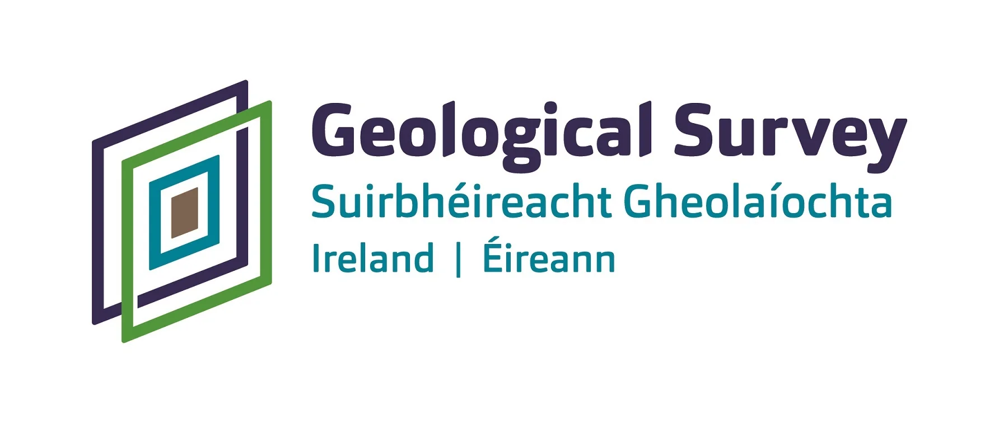

  
{fig-align="center" width=50%}

This course is designed to be used in conjunction with [CoreSpecViewer](https://github.com/Russjas/CoreSpecViewer). Download and install the software to get the 
most from this course.

# Part one 
  
Part one is an introduction to hyperspectral core scanning

[Launch slides](CoreSpecViewer-practical-training-part1.qmd)  

# Part two  

Part two is a step by step guide to working with hyperspectral data at the individual scan level in CoreSpecViewer.  
  
The data used in this presentation is from [here (2GB download)](https://aerccgrsprdmindat02.blob.core.windows.net/core-scanning/HSI/100131808811W500/100131808811W500_SWIR.zip) 
if you want to follow along.

[Launch slides](CoreSpecViewer-practical-training-part2.qmd)
  
# Part three
  
Part three is a step by step guide for working with hyperspectral data at the full hole level in CoreSpecViewer.  

*in production - coming soon*  
  
### Data and licence

The hyperspectral core scans used in this course (hole 00_13-18-088-11W5, boxes 101-114) are published by the
Alberta Geological Survey (AGS) and were downloaded from:

Alberta Geological Survey (2023): Core Data Interactive Map; Alberta Energy Regulator /
Alberta Geological Survey, AER/AGS Interactive App or Map 014,
<https://ags.aer.ca/publications/all-publications/iam-014> [accessed August 2026].

The scanning programme is indexed in Spectrum Geosciences Ltd. and TerraCore Geospectral
Imaging (2026): Index to hyperspectral core scanning imagery for mineral core from the
Athabasca Basin, Canadian Shield, and Western Canada Sedimentary Basin in Alberta;
Alberta Energy Regulator / Alberta Geological Survey, AER/AGS Special Report 129, 15 p.

Contains information licensed under the
[Open Government Licence – Alberta](https://open.alberta.ca/licence).