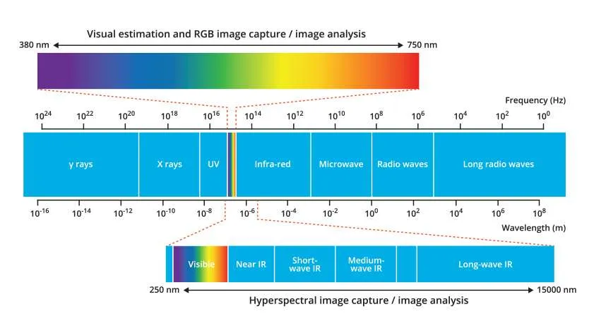
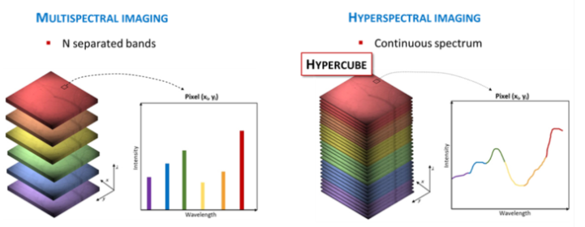
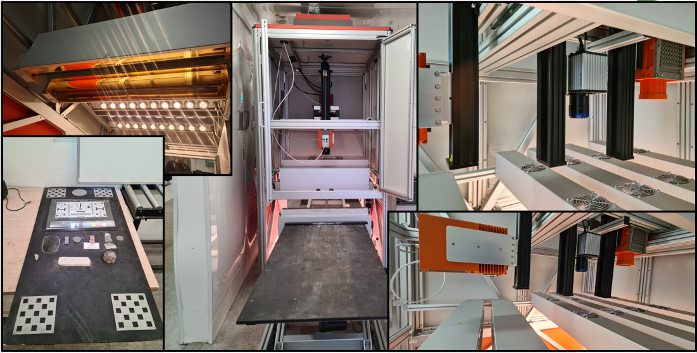
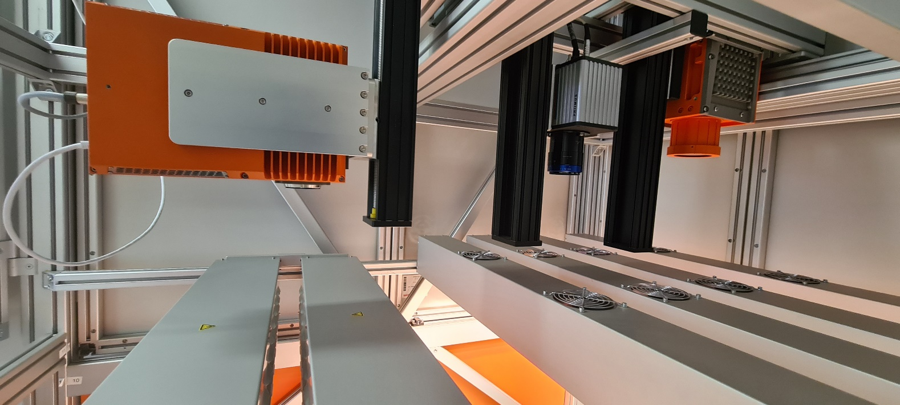
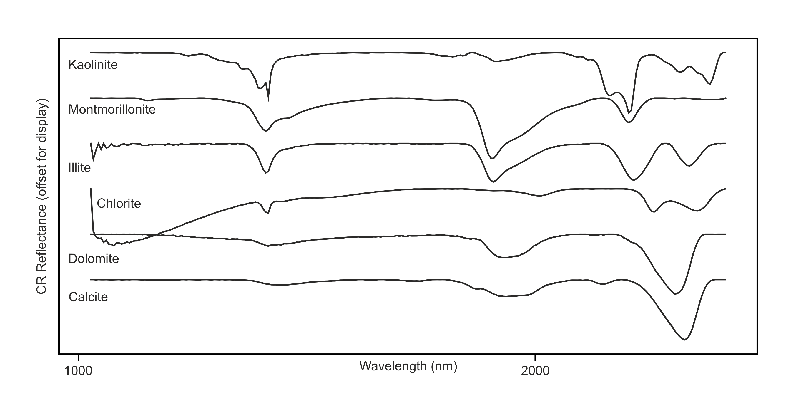

## What is Hyperspectral Imaging?

#### Some definitions

:::: {.columns}

::: {.column width="40%"}

{width="100%"}

::: {.source}
Figure taken from ruby-sapphire.com
:::

:::

::: {.column width="60%"}

**Visible light imaging**

These are the standard images we take on a phone or camera. The instrument samples three bands of the visible portion of the electromagnetic spectrum, red, green and blue.

**Spectral Imaging**

Spectral imaging samples the electromagnetic spectrum in multiple bands beyond the visible.

- Multispectral images capture 3–15 broad bands.
- Hyperspectral images capture hundreds of narrow contiguous bands across the electromagnetic spectrum.

:::

::::

---

## What is Hyperspectral Imaging?

{.slide-figure width="87%"}

- A hyperspectral image is a 3-dimensional array where z is wavelength.
- Spectral resolution is determined by number of bands, bandwidth and range. More bands and narrower bandwidth give higher spectral resolution.

::: {.source}
Image from: https://www.nireos.com/hyperspectral-imaging/
:::

---

## Where can we get hyperspectral images?  
  
### Geological Survey Ireland Core Scanning

{.slide-figure width="95%"}

Over 1400 drillholes scanned, producing >80TB of data. Intention to scan entire collection ~500km of drill core.

---

## Geological Survey Ireland Core Scanning {.camera-slide}

::: {.columns}
::: {.column width="54%"}

{width="100%"}

{width="100%"}

::: {.source}
Spectrum figure taken from ruby-sapphire.com
:::

:::
::: {.column width="46%"}

**Mid-Wave Infra-Red (MWIR) Camera**

- Bands: 154
- Range: 2712nm – 5274nm

**Short Wave Infra-Red (SWIR) Camera**

- Bands: 288
- Range: 978nm – 2580nm

**Visible light (RGB) Camera**

- Bands: 3
- Range: 440nm, 550nm, 630nm (discrete bands)

:::
:::

---

## Why do we care about hyperspectral images?

### Diagnostic Mineral Absorption features

- Energy of different wavelengths is absorbed or reflected.
- Absorption or reflectance can vary with mineral chemistry.
- Features known to be diagnostic of certain minerals can be observed in the spectra.

{.slide-figure width="91%"}

