## *In CoreSpecViewer:* Start with a single scan

**Open a hyperspectral core scan**

Launch CoreSpecViewer using the installation guide on the repository page.

- Note that you are on the **Raw** page, one of four pages
- Open the load dialogue, by clicking the **open** button at the top left of the interface.
- Examine the different data formats it can open.
- Open the Raw Lumo output directory from the downloaded data.
  
The following slides all assume that you are working with hole 100131808811W500 box 103. The output descriptions 
will not make any sense if you are using a different scan.

---

## Data Correction

:::: {.columns}

::: {.column width="40%"}

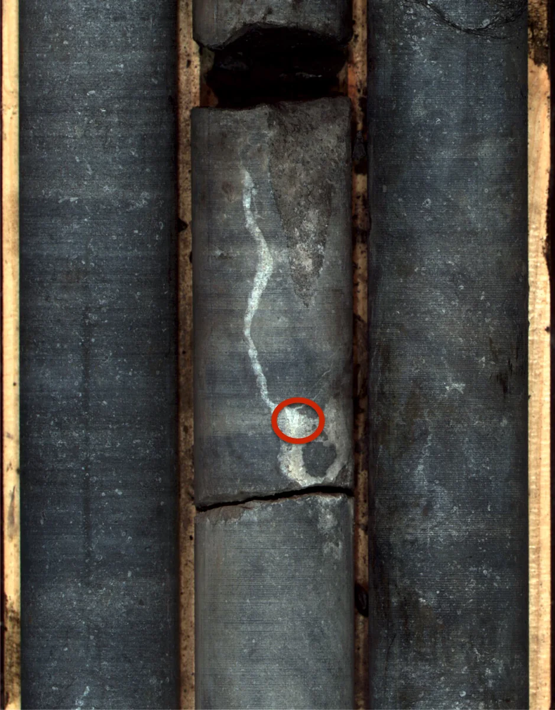{width="80%"}

:::

::: {.column width="58%"}

The area circled in red is part of a **calcite vein**.

A pixel from this vein will be used in the following examples.

:::

::::

---

## Data Correction
:::: {.columns}

::: {.column width="70%"}
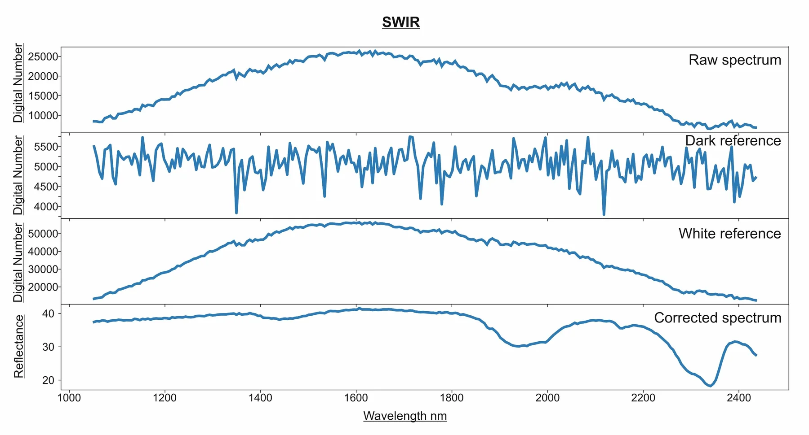{fig-align="center" width="83%"}

$$
\text{Reflectance (%)} = \frac{\text{Sample} - \text{Dark}}{\text{White} - \text{Dark}}\times 100
$$
:::

::: {.column width="28%"}

The image shows the data from a pixel of the calcite vein in the raw data, a spectrum of the dark reference and a 
spectrum of the white reference. The image is corrected to reflectance using the formula by CoreSpecViewer on load.

:::

::::
  
---

## *In CoreSpecViewer:* Open and Process

Raw page:

- Double-click a few pixels to see how directly you can interrogate the image.
- Click **Auto-crop**.
- Click **Undo**
- Manually crop the image.
- Click **Process**.

---

## Data Correction

#### Our calcite pixel

:::: {.columns}

::: {.column width="80%"}
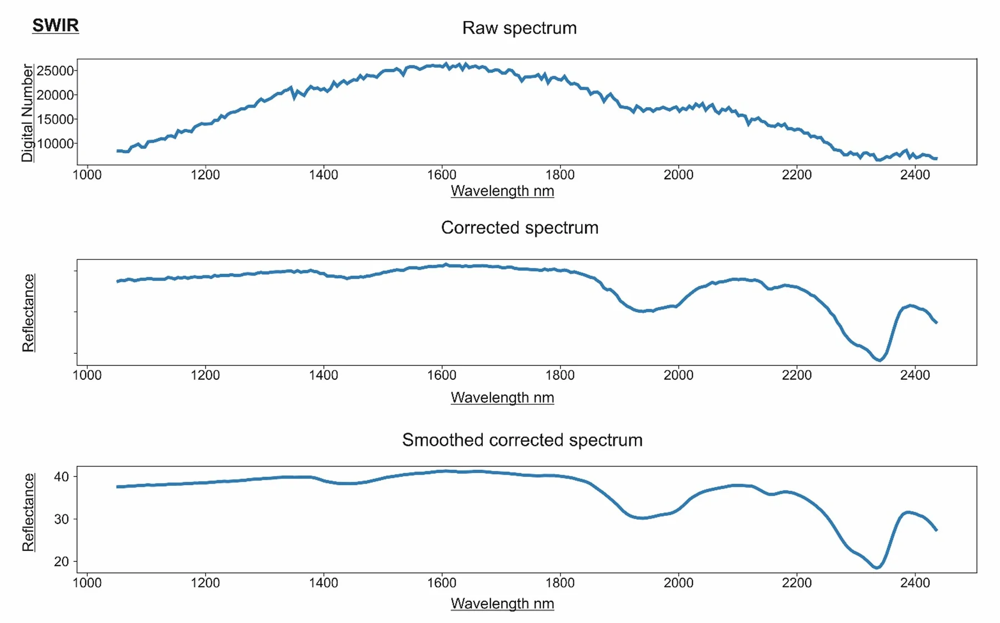

:::

::: {.column width="20%"}

By clicking **Process** CoreSpecviewer takes the cropped extent of the reflectance corrected scan and performs 
smoothing using the supplied parameters (default is Savitzky-Golay, window=11, polynomial-order=2)
:::

::::

---

## Convex Hull Quotient

:::: {.columns}

::: {.column width="57%"}

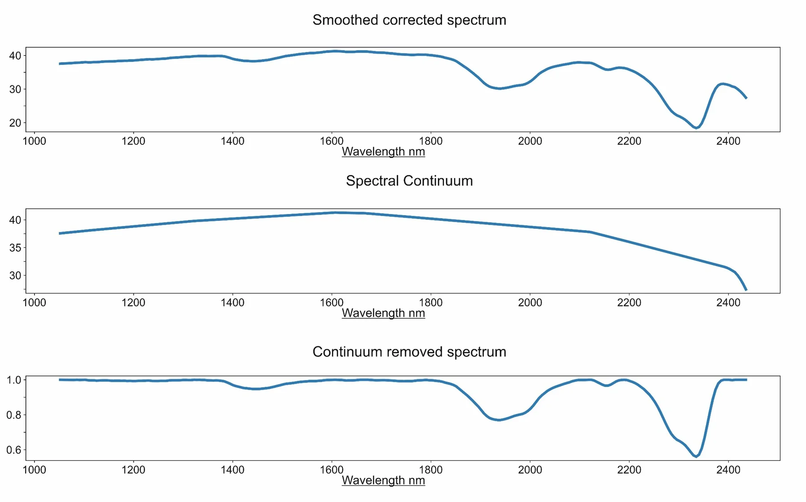{width="100%"}

:::

::: {.column width="41%"}

As further part of the **Process** operation:

- Continuum, or convex hull, is calculated.
- Spectrum is divided by the convex hull.
- All values are now 0–1.
- Features are more identifiable and spectra more comparable.

:::

::::

---

## *In CoreSpecViewer:* Processed Data

Visualise page:

- Look at the cached products table.
  - These are the pre-calculated derived products from Process
- Double-click some pixels.
  - This is the smoothed reflectance spectrum of the clicked pixel
- Right-click some pixels.
  - This is the continuum removed reflectance spectrum of the clicked pixel
- Examine the metadata available through the **Info** button.
- Click the **Settings** button.
  - These are the preset parameters that were used during processing.

---

## *In CoreSpecViewer:* Masking

Visualise page:

- Click **New Mask** — select a pixel of the core box itself.
- **Enhance Mask** — select a different pixel of the box.
- **Freehand Mask** — draw a polygon.
- Create a good core mask, marking non-core pixels.

---

## *In CoreSpecViewer:* Segmentation

Visualise page:

- Look at the box convention in **Settings**.
- Click **Calc Stats**.
- Open the **Segments** image.
- Click **Unwrap Preview**.
- Open the **DepthMap** image from the products table

---

## Unwrapping and Depth Registration

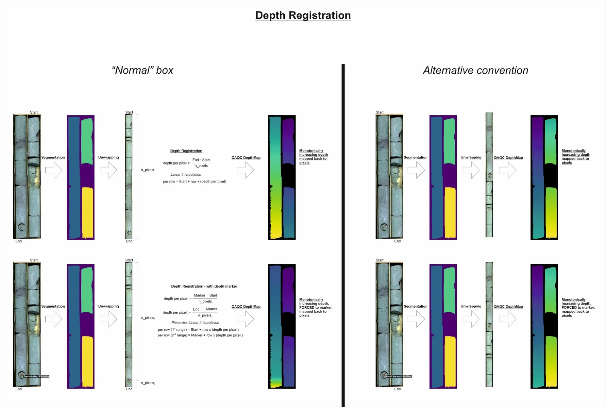{fig-align="center" width="100%"}

---

## *In CoreSpecViewer:* Depth Registration

Visualise page

- Check that your **DepthMap** is monotonically increasing in the correct convention.
- Click the **Info** button and check that the correct convention is embedded.
- Click **Save**.

**We now have a pre-processed data cube ready for interpretation.**

---

## *In CoreSpecViewer:* Spectral Exploration

Visualise page

- Click **Quick-cluster**.
- Use the default **5 clusters** and **50 iterations**.
- Examine the map.
- Double-click **Cluster Centres**.
- In the cluster centres window, double-click a class to view its centre.

---

## *In CoreSpecViewer:* Spectral Exploration

**Visualise page:**

- Click **Band Maths**.
- Run some indices in the dialogue. Using the equation to name the product is recommended.

Examples:

```text
R2320
R2350
R2250
R2250 / interp(R2150, R2350)
```

---

## Absorption Features {.smaller}


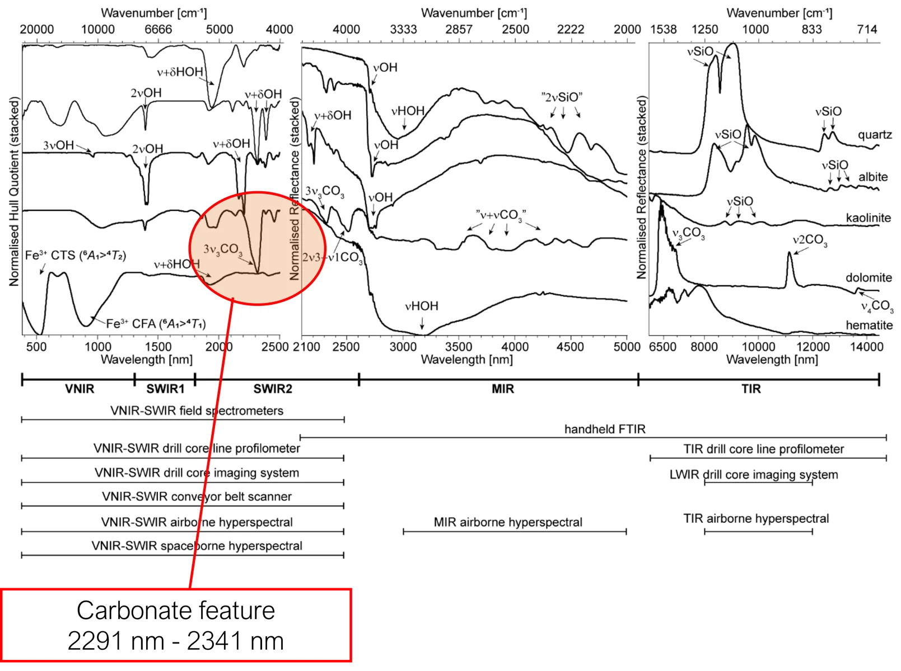{fig-align="center" width="100%"}


Reflectance spectra of major rock-forming minerals in the 500–14,000 nm wavelength region.

::: {.source}
Figures taken from Laukamp et al. (2021): *Mineral Physicochemistry Underlying Feature-Based Extraction of Mineral Abundance and Composition from Shortwave, Mid and Thermal Infrared Reflectance Spectra*. *Minerals*, 11(4), 347.
:::

---

## Absorption Features

:::: {.columns}

::: {.column width="57%"}

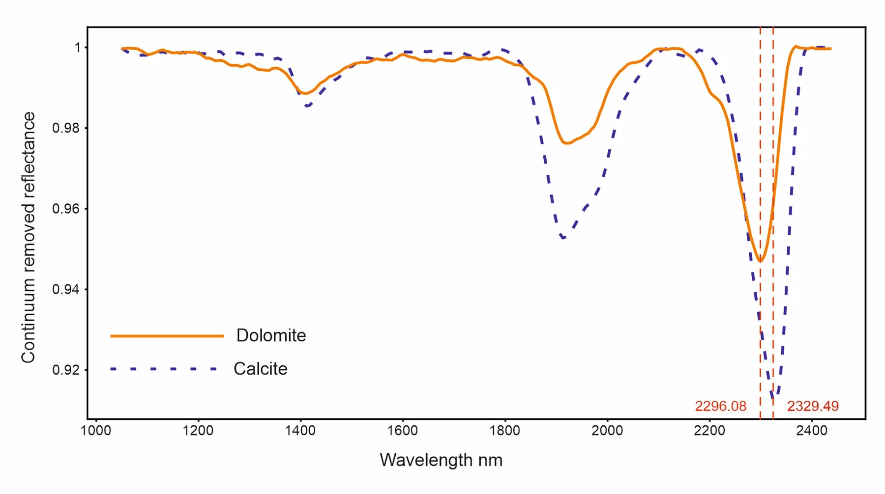{width="100%"}

:::

::: {.column width="41%"}

From library reference spectra and published research, the **2300 nm feature** is known to vary with carbonate composition.

- Longer wavelengths: more Ca-rich.
- Shorter wavelengths: more Mg-rich.

:::

::::

::: {.source}
Spectra taken from JPL spectral library. Meerdink, S. K., Hook, S. J., Roberts, D. A., & Abbott, E. A. (2019). The ECOSTRESS spectral library version 1.0. *Remote Sensing of Environment*, 230, 111196.
:::

---

## Feature Extractions
:::: {.columns}

::: {.column width="70%"}
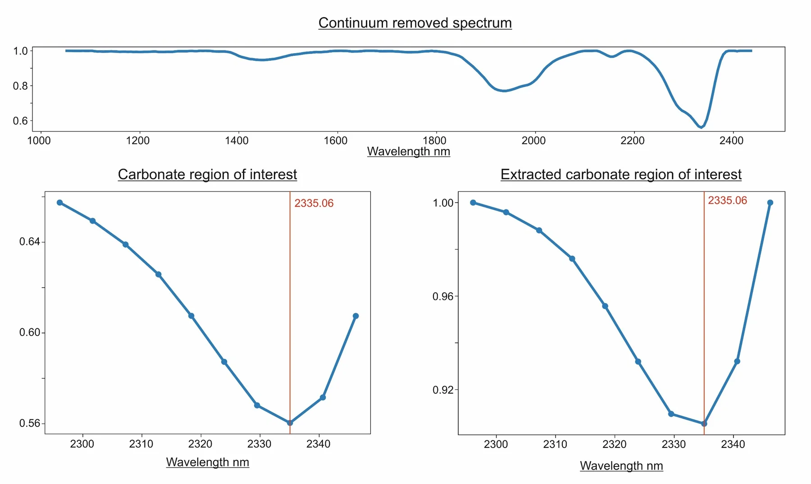{width="100%"}
:::
::: {.column width="30%"}
- Top continuum removed full spectral range
- Left: carbonate feature region plotted from the continuum-removed curve.   
- Right: continuum removed from the feature region of interest only.   
  
**NB:** different curve shape, but same minumum on measured band centre.
:::
::::

---

## Feature Extractions: Inter-band Fitting Minimum

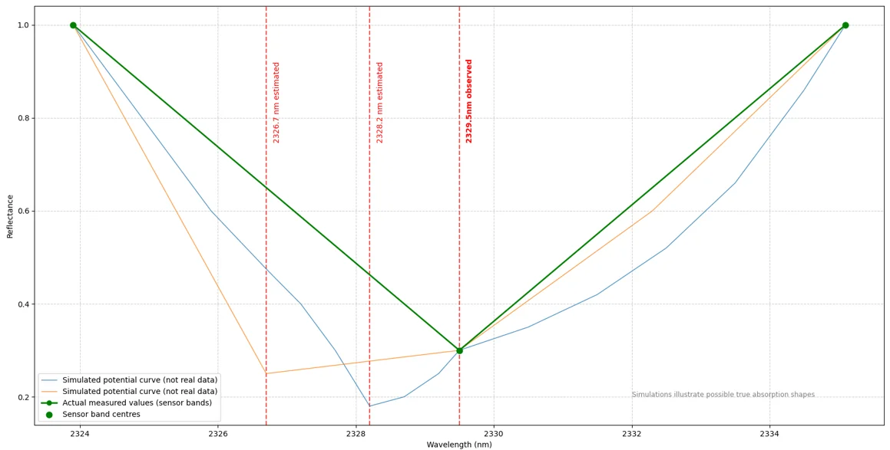{width="78%"}

**Many curves, with very different minima, can fit the measured data.**

---

## Feature Extractions: Inter-band Fitting Minimum {.smaller}

:::: {.columns}

::: {.column width="48%"}

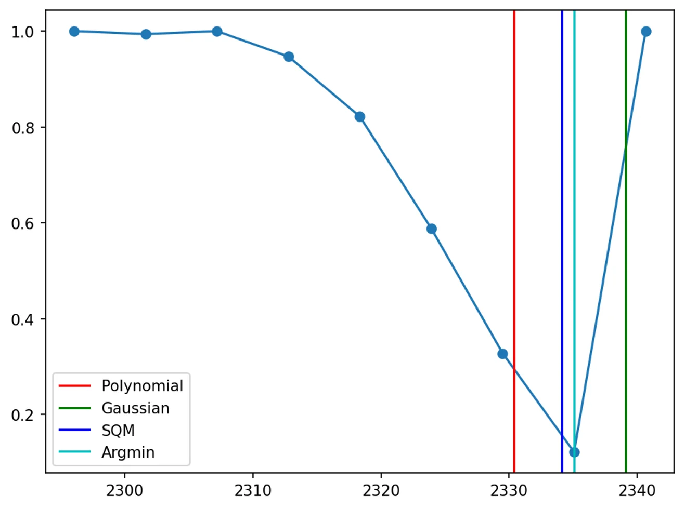{width="100%"}

:::

::: {.column width="50%"}

- **Argmin** — simple band-centre minima.
- **SQM** — quadratic polynomial fitting¹.
- **Polynomial** — higher-order polynomial fitting².
- **Gaussian** — multiple Gaussian curve fitting².

CoreSpecViewer defaults to **Polynomial fitting**, which can be changed in the source.

:::

::::

::: {.source}
¹ Rodger, A., Laukamp, C., Haest, M. & Cudahy, T. (2012). A Simple Quadratic Method of Absorption Feature Wavelength Estimation in Continuum Removed Spectra. *Remote Sensing of Environment*, 118, 273–283.

² Thiele, S. T. et al. (2021). Multi-scale, multi-sensor data integration for automated 3-D geological mapping. *Ore Geology Reviews*, 136, 104252.
:::

---

## Feature Extractions: Defined Ranges

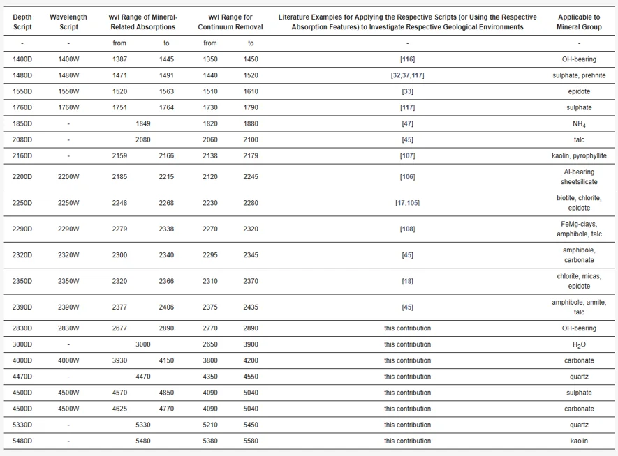{fig-align="center" width="67%"}

Table 5 from Laukamp et al. (2021). **Values for these features are hard-coded into CoreSpecViewer.**

::: {.source}
Laukamp, C. et al. (2021). Mineral Physicochemistry Underlying Feature-Based Extraction of Mineral Abundance and Composition from Shortwave, Mid and Thermal Infrared Reflectance Spectra. *Minerals*, 11(4), 347.
:::

---

## *In CoreSpecViewer:* Feature Extractions

Visualise page

- Click **Features** and in the dropdown select:
  - `2250W`
  - `2350W`
  - `2320W`
- Examine the feature maps.
- Right-click different feature-map regions to examine spectra.

---

## *In CoreSpecViewer:* Library and Spectral Correlation {.smaller}

The following instructions assume that you are using the Ecostress library version distributed with CoreSpecViewer.

Library page:

- Sort the library by mineral name.
- Scroll to the bottom to load every mineral.
- Type **C**, **a** to jump to calcite.
- Double-click and right-click a few calcite exemplars.
- Click **Filter to Current Band Range**.
- Examine **Calcite [116]**; click **Correlate** on the Library page and look at the coefficient values in the image.
- Examine **Dolomite [124]**; click **Correlate** on the Library page and look at the coefficient values in the image.

---

## *In CoreSpecViewer:* Library and Collections

Library page:

- Select **Calcite [116]**, click **Add to Collection**, name it `Demo1`.
- Select **Dolomite [124]**, add to collection `Demo1`.
- In the dropdown, select `Demo1`.

---

## *In CoreSpecViewer:* Mineral Mapping

Visualise page:

- Click **Correlations**.
- Select **MineralMap Pearson (Winner-takes-all)**.
- Choose the **in-range** collection.
- Examine the mineral map.
- Click **Correlations** again.
- Select **MineralMap Pearson (Winner-takes-all)**.
- Choose the `Demo1` collection.
- Examine the mineral map.

---

## *In CoreSpecViewer:* Mineral Mapping {.smaller}

Library page:

- Examine **Chlorite [1055]**; click **Correlate** and inspect coefficient values.
- Add **Chlorite [1055]** and the contents of `Demo1` to `Demo2`.

Visualise page:

- Run Pearson correlation on `Demo2` and examine the mineral map.
- Right-click gaps to inspect their spectra.

Library page:

- Add **Illite [969]** and the contents of `Demo2` to `Demo3`.
- Run Pearson correlation on `Demo3` and examine the mineral map.

---

## *In CoreSpecViewer:* Mineral Mapping

Library page:

- Add **Montmorillonite [1007]** and the contents of `Demo3` to `Demo4`.
- Click into montmorillonite-coloured spectra.
- Click **Correlations → Select Range → Pearson → 2000 to 2600**.
- Examine the mineral map.
- Run **Features** extraction on `1900W`.
- Examine the map.

---

## *In CoreSpecViewer:* Mineral Mapping

Visualise page:

- Click **Correlation → MineralMap SAM (winner-takes-all) → Demo4**.
- Examine the mineral map.
- Click **Correlations → Select Range → SAM → 2000 to 2600**.
- Examine the mineral map.

---

## *In CoreSpecViewer:* Saving and Exporting

Visualise page:

- Click **Save**.
- Click **Generate Images**.
- Click **Generate Box Report**.

---

## Single Scan Interpretation: Take-aways {.smaller}

- Information-dense datasets.
- Many tools to interpret the data.
- A combination of many approaches and geological knowledge of the core is the best way to extract the most understanding from the data.
- ML models, while not covered here, lack many of the weaknesses of this holistic approach, but introduce new weaknesses of their own.
- **Be wary of hyperspectral mineral maps, even if you know the exact methods used to produce them.**
